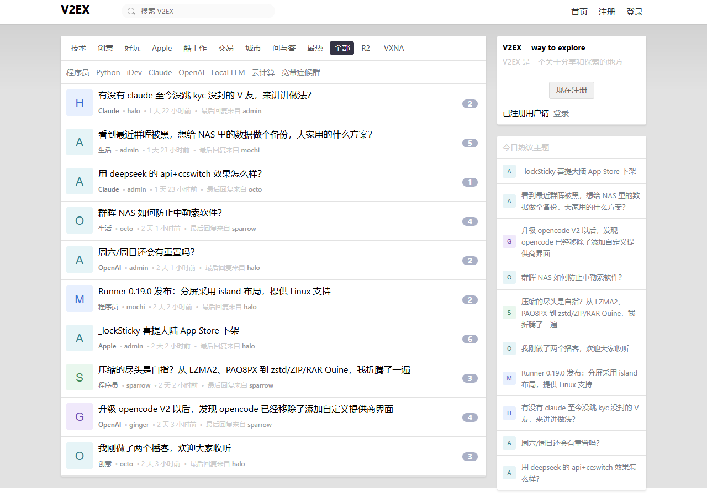
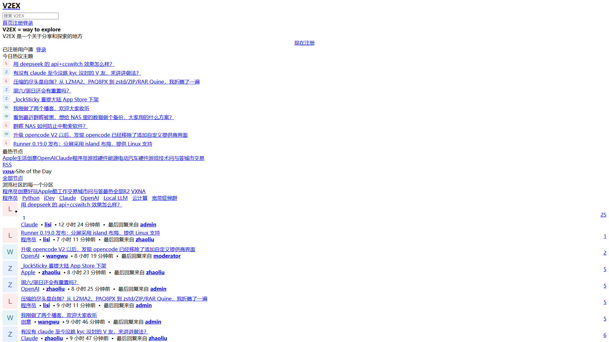
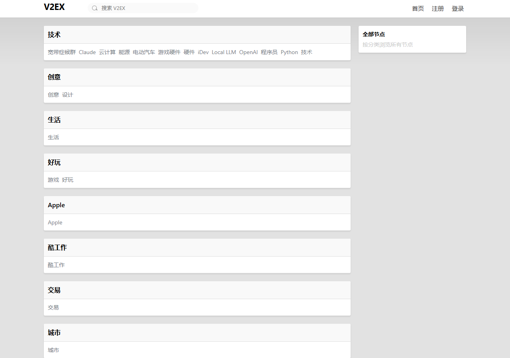
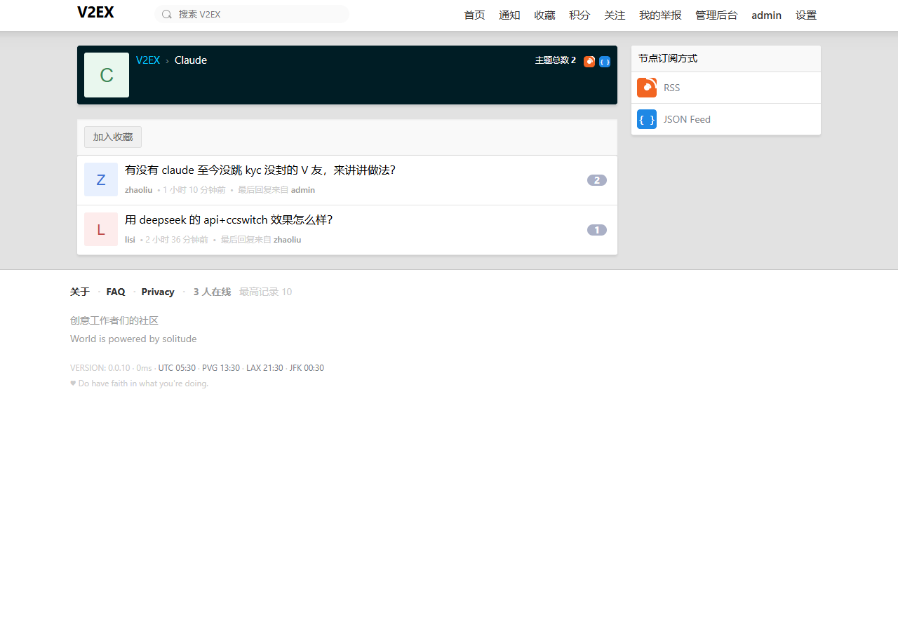
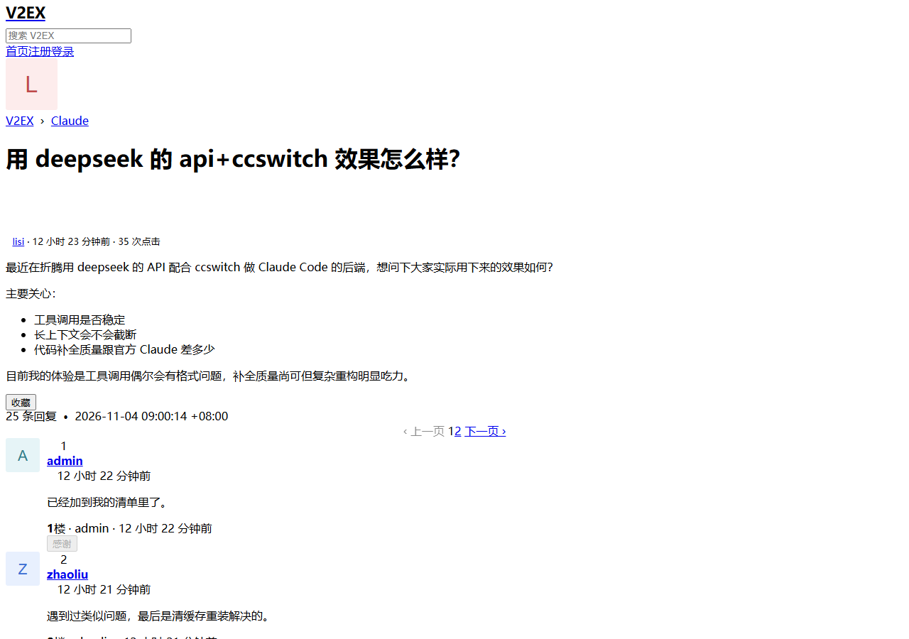
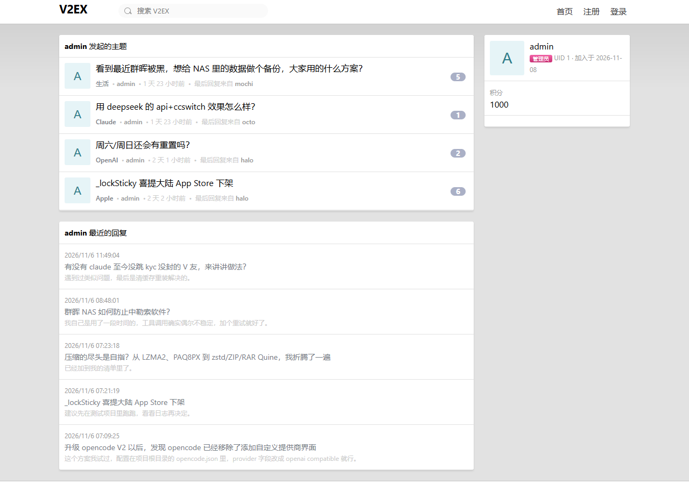
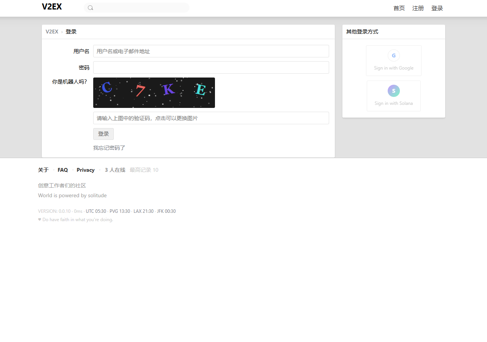
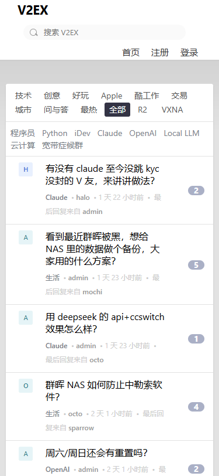

# V2EX Clone

> **⚠️ 独立非官方项目声明**
>
> 本项目是对 `https://www.v2ex.com/` 的**技术研究与高保真界面还原实验**。
>
> - 与 V2EX 官方**无任何关联**，**未获官方授权**，**不是** V2EX 官方产品
> - **不代表**任何形式的官方背书，MIT 许可证**不授予** V2EX 商标使用许可
> - **未复制**原站的私有源码、商标素材、用户数据或社区内容
> - 社区规则与功能设计参考了原站**公开页面**的公开说明（About / FAQ）
> - 仓库内所有代码、文档与数据均为本项目**独立编写 / 采集**
> - 仅供学习与研究用途；使用者需自行确保其使用方式符合所在地法律法规

---

## 项目简介

**一句话**：一个用 Next.js 15 + PostgreSQL 从零实现的社区论坛系统，
目标是还原 V2EX 的界面布局、URL 结构与核心交互行为，作为可运行、可审计的前端与后端研究工程。

**技术栈**：Next.js 15 · React 19 · TypeScript 6 · PostgreSQL 17 · Redis（可选）· Drizzle ORM · Playwright

---

## 当前版本状态（v0.0.13 开发中）

> **版本载体**：`0.0.12`
> （机器可校验的版本锚点，由 `scripts/release/sync-version.mjs` 维护；
> 开发态刻意保持上一稳定版本，固定最终 SHA 后一次性同步到目标版本。）

| 项 | 值 |
|---|---|
| **当前实际公开版本** | **`v0.0.12`**（GitHub Pre-release，含部署 ZIP 与 GHCR 镜像，2026-11-08 发布） |
| **当前开发版本** | **`v0.0.13`（候选，未打 Tag、未发布 Release）** |
| 版本载体 | 开发分支刻意保持 `0.0.12`；**只有固定最终 SHA 后才统一同步到 `0.0.13`**（`node scripts/release/sync-version.mjs 0.0.13`） |
| 发布形态 | 开发预览版（Pre-release），**不是稳定版** |
| 语义化版本位置 | `0.0.x` —— 早期阶段，**不承诺 API 稳定性** |
| 许可证 | MIT（附商标声明与第三方内容声明） |
| 已发布镜像 | `ghcr.io/alicia1030su/v2ex-clone:v0.0.12` |
| 数据库迁移 | `drizzle/` 下 4 个 SQL（`0000_init` / `0001_striped_magdalene` / `0002_v004_perf_indexes` / `0003_v005_reports`），容器启动时幂等执行 |

> **v0.0.13 定位**：旧版 API 兼容收口、功能矩阵真实性、登录交互稳定性与完整发行候选。
> 本版**不重新开发论坛**，也不启动 v0.0.14。
>
> - 新增旧版端点：`/api/topics/hot.json`、`/api/replies/show.json`、`/api/nodes/list.json`
>   （上一轮「全量审计」漏掉了它们，完整 15 项核对见
>   [`docs/LEGACY_API_MATRIX_v0.0.13.md`](docs/LEGACY_API_MATRIX_v0.0.13.md)）
> - 接口规格与 Feed 格式区分见 [`docs/API_SPEC.md`](docs/API_SPEC.md) §14
> - 功能矩阵与当前证据见 [`docs/FEATURE_MATRIX.md`](docs/FEATURE_MATRIX.md)
> - 交接、门禁与授权边界见 [`docs/SESSION_HANDOFF_v0.0.13.md`](docs/SESSION_HANDOFF_v0.0.13.md)
>
> ⚠️ **R-01 历史版权风险仍未清理**，本版公开发布需主人单独授权；
> 详见 [`RISK_REGISTER.md`](RISK_REGISTER.md) 与 `docs/R01_COMPLIANCE_REVIEW_v0.0.9.md`。

> **开发预览版的共同限制（v0.0.12 / v0.0.13 均适用）**
>
> - **不保证与 V2EX 完全一致** —— 页面内容、交互细节与原站存在差异
> - **不具备生产就绪条件** —— 1 小时持续运行已真实通过；**24 小时持续运行尚未完成**
> - **不建议用于生产环境** —— 请先完成 `deploy/INSTALL.md` 的安全清单
>
> ### 从旧版本升级
>
> 已实测升级基线为 **v0.0.4**（`docs/UPGRADE_VERIFICATION_v0.0.10.md`）；
> v0.0.13 的官方升级路径是 **v0.0.12 → v0.0.13**，由本版 CI 的
> 原地升级与备份恢复门禁验证（结果见交接文档）。
> `./update.sh --version <目标版本>` 会改写 `.env` 里的 `V2EX_IMAGE` 并在失败时回滚；
> **升级前务必先 `./backup.sh`**。详见 [`deploy/INSTALL.md`](deploy/INSTALL.md) §8。

<details>
<summary>历史：为什么 v0.0.10 的 Tag 从未发布（v0.0.10 ~ v0.0.12 的旧说明，仅供追溯）</summary>

v0.0.10 的 Tag 已创建，但其内容里 `deploy/README.md` 的标题仍写着 `v0.0.9`
（该文件从未纳入版本同步），被发布流水线的「包内版本一致性（N2）」正确拦截。
补救路径要求 `deploy/` 与 Tag 零差异 ⇒ 修改该文件必然破坏补救前提 ⇒ 二者互斥。
由于 Tag 不可移动，改以 v0.0.11 承载同一份代码；随后 v0.0.12 补齐
`deploy/` 下 12 个文件的版本标注并**正式发布**。
详见 [`docs/RELEASE_BLOCKER_v0.0.10.md`](docs/RELEASE_BLOCKER_v0.0.10.md)。
**v0.0.10 的 Tag 从未发布**（无 Release、无安装包），保留但不再使用。

</details>

### 版本历史

| 版本 | 主要内容 |
|---|---|
| **v0.0.13**（开发中，未发布） | **旧版 API 兼容收口 + 真实性治理 + 登录稳定性**：补齐 `hot.json` / `replies/show.json` / `nodes/list.json` 三个实测仍返回 200 的旧版端点；建立 15 项兼容矩阵并披露未验证项；统一旧版端点的 member/node 装配器（修复 `nodes/show.json` 不限制 active 的跨接口偏差）；Feed 增加严格 XML 转义、ETag/304 与真实阅读器订阅验证；`clickUntilRequest` 加三道闸门防止非幂等写操作重复提交；功能矩阵改为六类状态并加文档真实性护栏；修正 README / CHANGELOG 的过时版本说明 |
| **v0.0.12** | **v0.0.11 的正式发行载体**：代码与 v0.0.11 完全一致，仅补齐 `deploy/` 下 12 个文件的版本标注（此前只有 7 个被 `sync-version.mjs` 覆盖，导致 v0.0.10 / v0.0.11 的 Tag 内容被发布流水线的 N2 判据正确拦截、两轮 Tag 均未发布）。同时把 N2 判据复刻进本地门禁，发版前即可拦住同类问题 |
| **v0.0.11** | **v0.0.10 的正式发行载体**：内容与 v0.0.10 完全一致，仅修复一处**版本载体遗漏** —— `deploy/README.md` 的标题行从未纳入 `sync-version.mjs`，导致 v0.0.10 的 Tag 内容里写着 `v0.0.9`，被发布流水线的 N2「包内版本一致性」正确拦截。v0.0.10 的 Tag 因此**从未发布**（无 Release、无安装包），保留但不再使用 |
| **v0.0.10** | **安装与备份可靠性 + 页面真实性**：Linux 发布包脚本可执行位（V9-09）与 `backup.sh`/`restore.sh` 的 SIGPIPE 假失败（V9-13）已在**产物层**修复并加门禁；新增双基线真实升级验证（v0.0.4 / v0.0.9 → v0.0.10）；新增发行版真实性门禁（源码/Tag/镜像/ZIP/README/Release 六项一致才允许发布）；新增带登录态的全站页面审计（12 类页面 × 23~29 项断言）；页脚版本号改为构建期注入、最高在线改为真实记录；顶栏阴影带由 118px 修正为原站实测的 30px |
| **v0.0.9** | **视觉真实性整改**：修复「README 截图无样式」事故的根因（截图工具假成功机制）；新增页面健康门禁 + 5 个负向测试；修复 7 项真实版式/资源缺陷（回复操作按钮被裁切、主题页缺右栏、`/xna` 空档、5 个 RSS 死链、回复数徽章白字从未生效、tab 无选中态、整页被渐变压暗）；「最热」tab 长期 500 修复；候选离线安装链路与可观测性修复 |
| **v0.0.4** | 修复 11 项真实缺陷（含 3 项本轮新发现：`docker-verify.yml` 定义级失败 / 迁移物路径断言错误 / 运行时上传数据误入仓）；3 项性能优化；真实社区规模压测；升级脚本自动同步镜像 tag；发布前只读门禁 |
| v0.0.3 | 主题/回复生命周期（编辑、软删除、恢复、锁定置顶、投票、感谢）、邮件找回密码、积分体系、节点与 Feed 订阅、后台管理、响应式适配 |
| v0.0.2 | 限流信任边界修复、供应链漏洞清零、Windows 安装脚本修复、生产镜像裁剪、发布流水线修复 |
| v0.0.1 | 首个公开版本（开发预览） |

> **v0.0.5 ~ v0.0.8 从未公开发布**（未打 Tag、未出 Release），因此**不存在**这几版的
> 下载页与镜像标签。唯一可用于升级验证的公开基线是 **v0.0.4**。


---

## 功能完成度

### 已实现（本版本真实可用的功能）

| 模块 | 状态 | 说明 |
|---|---|---|
| 注册 | ✅ | 用户名大小写不敏感唯一；密码 8–128 字符 |
| 登录 | ✅ | scrypt 密码哈希；账号状态校验（封禁返回 403） |
| 退出 | ✅ | 删除服务端 session 行 + 清 Cookie |
| 会话保持 | ✅ | 服务端 session 表 + HttpOnly / SameSite=Lax Cookie |
| 修改密码 | ✅ | 需校验旧密码；受限流保护 |
| 验证码 | ✅ | 服务端生成 320×80 SVG；答案哈希存储、字段名哈希化、一次性 |
| 用户个人主页 | ✅ | `/member/[username]` |
| 节点列表 / 详情 | ✅ | `/nodes`、`/go/[name]` |
| 子节点树 | ✅ | `nodes.parentId` + 递归渲染 |
| 节点创建 | ✅ | 管理员直生效；版主进待审队列 |
| 节点审核 | ✅ | 仅管理员可 approve / hide |
| 节点收藏 | ✅ | 与主题收藏语义独立 |
| 主题发布 | ✅ | 标题 4–128 字符；正文 10–50000 字符 Markdown |
| 主题列表 | ✅ | 首页与节点页分页 |
| 主题详情 | ✅ | 楼层连续、锚点可跳转 |
| 主题浏览计数 | ✅ | 每次访问 +1 |
| Markdown 渲染 | ✅ | 渲染前经 `sanitize-html` 白名单清洗 |
| 回复发布 | ✅ | 楼层号原子分配；主题锁定时拒绝 |
| 回复分页 | ✅ | 页码导航 |
| 感谢数展示 | ✅ | 计数展示 + 点击「感谢 / 已感谢」切换（`POST`/`DELETE /api/thanks`，见 `src/components/ReplyItem.tsx`） |
| 收藏（主题 / 节点） | ✅ | 支持取消；收藏列表页 `/bookmarks` |
| 通知 | ✅ | 回复通知自动生成 + 未读计数 + `/notifications` |
| 搜索 | ✅ | 顶栏 AJAX 联想 + 结果页；主题 / 节点 / 会员三类 |
| 管理后台 | ✅ | `/admin` 概览、待审列表、操作日志 |
| 用户权限 | ✅ | 三级角色 `user` / `moderator` / `admin`，操作级校验 |
| 限流 | ✅ | 登录 / 注册 / 发帖 / 回复 / 建节点 |
| CSRF 防护 | ✅ | 双提交 Cookie 模式 |
| XSS 清洗 | ✅ | 标签 / 属性 / 协议 / 样式白名单 |
| 开放跳转防护 | ✅ | 仅允许站内相对路径 |
| 安全响应头 | ✅ | nosniff / SAMEORIGIN / Referrer-Policy |
| 数据持久化 | ✅ | PostgreSQL 17 + Drizzle ORM 迁移 |
| Redis 可选降级 | ✅ | 未配置 Redis 时自动降级到 PostgreSQL，语义等价 |
| Docker 部署 | ✅ | 多阶段镜像 + Compose + 三阶段启动 |

### v0.0.3 新增能力（真实可用的功能）

> 逐项状态与证据见 [`FEATURE_MATRIX.md`](FEATURE_MATRIX.md)（58 项需求，逐项标注实现位置与验证证据）。

| 模块 | 状态 | 说明 |
|---|---|---|
| 主题编辑 | ✅ | 作者本人或管理员；可配置编辑时限；每次编辑写 `edit_history` 快照 |
| 主题软删除 / 恢复 | ✅ | 内容保留在库中，普通列表与详情一律不可见；管理员可恢复 |
| 回复编辑 / 软删除 / 恢复 | ✅ | 同上；软删除后同步重算 `topics.replies_count` |
| 主题锁定 / 解锁 | ✅ | 仅 moderator/admin；锁定后禁止新回复；写审计日志 |
| 主题置顶 / 取消置顶 | ✅ | 仅 moderator/admin；写审计日志 |
| 主题投票 | ✅ | 一人一主题唯一；重复投票幂等；改票按差额 ±2 调整汇总 |
| 回复感谢 | ✅ | 一人一回复唯一；重复感谢幂等；计数与 `thanks` 表行数一致 |
| 回复引用与楼层跳转 | ✅ | `replies.quoteId` + 楼层锚点 |
| 邮件找回密码 | ✅ | 防邮箱枚举（响应完全一致）；未配置 SMTP 时如实显示未送达 |
| 一次性重置令牌 | ✅ | 只存 sha256 哈希；过期/撤销/重放三重防护；改密后旧会话失效 |
| 头像上传 | ✅ | magic number 嗅探（不信任 MIME 声明）；服务端生成随机路径防路径穿越 |
| 关注 / 取消关注 | ✅ | 唯一索引幂等；不能关注自己 |
| 通知已读 / 全部已读 / 删除 | ✅ | 只能操作自己的通知 |
| 积分流水与余额 | ✅ | 不可篡改账本（含变动前后余额快照）；行锁保证并发扣费不产生负余额 |
| 每日签到 | ✅ | 同一天只发一次奖励；连续签到天数递增 |
| 积分排行榜 | ✅ | 含发帖数/回复数/被感谢数 |
| 节点分类、子节点、面包屑 | ✅ | 面包屑含环检测（最多 10 层） |
| 节点创建审批 | ✅ | 普通用户申请 → 管理员审批 → 真正创建节点 |
| 搜索分页 / 排序 / 过滤 | ✅ | 参数化查询（不拼 SQL）；分页上限 100 |
| RSS / Atom / JSON Feed | ✅ | 站点与节点两级；真实数据库内容；软删除主题不出现 |
| 后台管理（13 个 API） | ✅ | 用户/举报/审核/内容隐藏/节点审批/操作日志/系统配置/社区统计。复核：`find src/app/api/admin -name "route.ts" \| wc -l` → **13**（2026-11-04 实测） |
| 响应式适配 | ✅ | 600px / 500px 断点（沿用原站断点值）；375px 视口无横向滚动 |
| 键盘可访问性 | ✅ | `:focus-visible` 焦点可见；全部交互元素可 Tab 聚焦；尊重 `prefers-reduced-motion` |

### 仍未实现（本版本**完全未实现**）

> 以下能力在 v0.0.13 中**没有实现**（v0.0.12 同样没有）。
> 项目**不提供**任何形式的假实现 —— 没有占位按钮、没有假接口、没有静态演示数据冒充。
> 若你在页面上看到一个不工作的按钮，那是因为**功能没做**，而不是「点了没反应」。

| 能力 | 现状 | 底层准备情况 |
|---|---|---|
| 邮件送达的端到端验证 | ⚠️ 部分 | SMTP 客户端与令牌流程已实现并测试；**本机未配置真实 SMTP 服务器**，未验证真实投递 |
| 头像自动裁剪 | ✅ **已实现** | `sharp@0.35.5` 为生产依赖（`src/lib/avatar.ts` → `processAvatar`）：EXIF 方向校正 → 居中裁正方形 → 重编码并**剥离全部元数据**（含 GPS）；`limitInputPixels` 防图片炸弹。sharp 缺失时降级保存原图 |
| 举报入口（主题 / 回复） | ✅ **已实现** | `src/components/ReportButton.tsx` 已接入主题页与回复卡片；后台 `/admin` 举报处理页可用 |
| 节点申请的前端入口 | ✅ **已实现** | `/nodes/request` 页 + `NodeRequestForm`（v0.0.4 `ed385cf` 补齐、`bddb3d0` 修复 V4-20 水合崩溃）+ 后台审批 tab |
| RSS 阅读器集成 | ❌ **未实现** | Feed 已输出标准格式（RSS / Atom / JSON），未做站内聚合页 |
| 全文搜索（PostgreSQL FTS） | ❌ **未实现** | 当前为 `ILIKE` 模糊匹配 + `pg_trgm` 索引 |
| 多语言 / i18n | ❌ **未实现** | — |
| 私信 / 站内信 | ❌ **未实现** | — |

## 页面截图

> 以下截图均为**本项目本地运行的真实渲染结果**（`local-*.png`），由 Playwright 在
> `desktop-1280` / `desktop-1920` / `tablet-768` / `mobile-375` 四个视口下采集。
>
> **每张截图都必须先通过「页面健康门禁」才会被写盘**（`tools/visual/lib/page-health.mjs`）。
> 门禁逐项断言：HTML 2xx、最终 URL 正确、CSS/JS 请求全部成功、样式表真的解析出规则、
> `#Wrapper` 灰底 = `rgb(226,226,226)`、`.box` 白卡 + 阴影 + 3px 圆角、默认蓝链接 0 个、
> 内容区居中 1100px、桌面必须双栏、无横向溢出、图片全部加载、无控制台 error、布局已稳定。
> **任一项不过 ⇒ 拒绝出图**，只把现场图写进 `docs/evidence/visual/health/*-INVALID.png`，
> 并让任务以退出码 1 失败。也就是说：**README 里不可能再出现「没有样式」的截图**。

### 首页（`desktop-1280`）



### 首页（`desktop-1920`）



### 全部节点



### 节点详情页



### 主题详情页



### 用户主页



### 登录页（含服务端验证码）



### 移动端首页（`mobile-375`）



多视口几何测量、像素比对与**未解决差异清单**见 [`docs/VISUAL_DIFF_REPORT.md`](docs/VISUAL_DIFF_REPORT.md)；
门禁判据与逐项证据见 [`docs/VISUAL_AUTHENTICITY_v0.0.9.md`](docs/VISUAL_AUTHENTICITY_v0.0.9.md)。

---

## 一键部署

### 方式 A：一键安装包（推荐）

> ✅ **v0.0.12 是已正式发布的 Pre-release**，部署 ZIP 与 GHCR 镜像均可获取。
> 下面的命令以 v0.0.12 为例；v0.0.13 尚未发布，请勿把 v0.0.13 写进
> `--version`/镜像标签直至正式发布完成。
> 更旧的 **v0.0.9** 安装包存在两处已确认缺陷（V9-09 脚本缺可执行位、
> V9-13 `backup.sh` 的 SIGPIPE 假失败），已发布资产按「不得覆盖已有 Release」
> 的规约保持原样 —— **建议使用 v0.0.12，不要用 v0.0.9**。

下载 `v2ex-clone-v0.0.12-deploy.zip` 并解压。

> 解压后会得到 `deploy/` 目录，安装脚本在里面：
> `unzip v2ex-clone-v0.0.12-deploy.zip -d v2ex-clone-v0.0.12-deploy && cd v2ex-clone-v0.0.12-deploy/deploy`
>
> ✅ v0.0.12 的安装包内 `deploy/*.sh` **自带 0755 可执行位**（打包器显式写入
> ZIP 中央目录的 Unix mode，并在 `verify-release-consistency.sh` 里回读断言），
> **不需要**先 `chmod +x`。若你下载到的包需要 chmod，说明产物不对，请报告。

**Linux / macOS：**

```bash
./install.sh
```

**Windows（PowerShell）：**

```powershell
powershell -ExecutionPolicy Bypass -File .\install.ps1
```

安装完成后访问 **http://localhost:3000**。

安装包下载：<https://github.com/alicia1030su/v2ex-clone/releases>

### 方式 B：手动 Docker Compose

```bash
# 克隆仓库
git clone https://github.com/alicia1030su/v2ex-clone.git
cd v2ex-clone

# 生成配置文件并填写必填项
cp .env.example .env
#   至少需要设置：POSTGRES_PASSWORD / REDIS_PASSWORD / SESSION_SECRET / SEED_ADMIN_PASSWORD

# 启动
docker compose up -d
```

详见 [`docs/INSTALL.md`](docs/INSTALL.md)（安装手册）与 [`docs/DEPLOYMENT.md`](docs/DEPLOYMENT.md)（部署手册）。

---

## 系统要求

| 项 | 要求 | 说明 |
|---|---|---|
| 操作系统 | Linux / macOS / Windows | Windows 走 PowerShell 安装脚本 |
| Docker | **20.10+** | 必需 |
| Docker Compose | **v2**（`docker compose` 子命令形式） | 必需；v1 的 `docker-compose` 不支持本项目的 compose 文件 |
| 可用磁盘 | **2 GB 以上** | 镜像约 400 MB，数据库与日志占用随使用增长 |
| 可用内存 | **2 GB 以上** | PostgreSQL + Redis + 应用三容器同时运行 |
| 端口 | **3000**（可改） | 应用对外端口；数据库与缓存端口**不对外暴露** |
| 网络 | 首次启动需能拉取镜像 | `docker pull postgres:17-alpine` / `redis:7-alpine` / 应用镜像 |

本地开发另需 **Node.js ≥ 22.23.4** 与 PostgreSQL 17（Redis 可选）。

---

## 下载入口

| 内容 | 位置 |
|---|---|
| **发布页面（含全部安装包）** | <https://github.com/alicia1030su/v2ex-clone/releases> |
| **最新已发布版本（v0.0.12）** | <https://github.com/alicia1030su/v2ex-clone/releases/tag/v0.0.12> |
| 一键部署安装包（v0.0.12，已发布） | `v2ex-clone-v0.0.12-deploy.zip`（在该 Release 资产中） |
| 容器镜像（v0.0.12，与安装包同版） | `ghcr.io/alicia1030su/v2ex-clone:v0.0.12` |
| 历史版本（v0.0.9） | <https://github.com/alicia1030su/v2ex-clone/releases/tag/v0.0.9>（含已知缺陷，不建议新装） |
| v0.0.13 | **尚未发布**：无 Tag、无 Release、无镜像标签；开发候选状态见交接文档 |
| 源码 | <https://github.com/alicia1030su/v2ex-clone> |

> 镜像拉取需要 GHCR 包为 **public** 才能匿名 `docker pull`。
> 若提示 `denied` 或 `unauthorized`，说明该包尚未开放匿名拉取，请改用「方式 B」本地构建。

---

## 开发

### 本地开发

```bash
npm install

cp .env.example .env.local      # 填入 DATABASE_URL / SESSION_SECRET / SEED_ADMIN_PASSWORD
npm run db:migrate              # 应用 Drizzle 迁移
npm run db:seed                 # 写入初始分类 / 节点 / 用户 / 主题
npm run dev                     # http://localhost:3000
```

**初始账号**（仅非生产环境创建）：

| 角色 | 用户名 | 口令来源 |
|---|---|---|
| 管理员 | `admin` | `SEED_ADMIN_PASSWORD`（生产必填，≥12 位） |
| 普通用户 | `lisi` / `wangwu` / `zhaoliu` | `SEED_DEMO_PASSWORD`（未设置则随机生成并打印） |
| 版主 | `moderator` | 同上 |

> 生产环境**不会**创建演示账号，也不会接受缺失或过弱的管理员口令 —— seed 会直接报错退出。
> seed 采用「**只初始化、不修改**」语义：账号已存在时**不会**覆盖其口令与角色。
> 口令与角色的变更必须走授权流程：
>
> ```bash
> export ADMIN_CLI_TOKEN=$(openssl rand -base64 32)
> npm run admin -- set-password --username lisi --password 'NewPassw0rd!' --reason '用户申诉后重置'
> npm run admin -- set-role --username lisi --role moderator --reason '任命为版主'
> npm run admin -- list-admins
> ```

### 常用命令

| 命令 | 作用 |
|---|---|
| `npm run dev` | 开发模式（热更新） |
| `npm run build` | 生产构建 |
| `npm run start` | 启动生产构建产物 |
| `npm run db:generate` | 根据 schema 生成迁移 |
| `npm run db:migrate` | 应用未执行的迁移 |
| `npm run db:seed` | 初始化基础数据（只初始化，不覆盖已有账号） |
| `npm run admin -- <子命令>` | 运维 CLI（改密 / 改角色 / 列管理员） |
| `npm run test:unit` | 单元测试（vitest） |
| `npm run test:e2e` | E2E 测试（playwright） |
| `./scripts/verify.sh` | 完整验证：类型检查 → 构建 → 干净库迁移 → seed → 单元 → E2E |

### 测试

```bash
npm run test:unit                            # 单元测试
LOCAL_BASE=http://localhost:3000 npm run test:e2e   # E2E 测试
./scripts/verify.sh                          # 一键完整验证
./scripts/verify.sh --skip-e2e               # 跳过 E2E
```

> **口径原则**：只写**能复现的实测数字**。取数命令写在旁边，任何人都能一条命令复核；
> 静态 grep 不算口径（部分 spec 用嵌套 for 生成用例），**必须取 Vitest 运行时的 `numTotalTests`**。

| 套件 | 用例数 | 命令 | **v0.0.12 历史实测**（非当前结论） |
|---|---|---|---|
| 单元测试（vitest） | **444**（36 个 spec 文件） | `npm run test:unit` | **444 passed / 0 failed / 0 skipped**，**36/36 文件全绿**（2026-11-08，本机隔离实例） |
| E2E（Playwright） | **220**（20 个 spec 文件） | `npm run test:e2e` | **220 passed / 0 failed / 0 skipped**（8.1m，本机 `next start` + 独立库） |
| 视觉健康门禁 | **6 个页面 × 18 项判据** | `node tools/visual/diagnose.mjs --all` | **6/6 页面通过**（含 CSS/JS 加载、双栏几何、计算样式、无溢出） |
| 门禁负向测试 | **5 个坏页面场景** | `node tools/visual/negative-tests.mjs` | **5/5 被正确拒绝**（无 CSS / 静态资源全挂 / 错误路由 / 站点 502 / 单栏塌陷） |

> ⚠️ **必须注入测试环境变量**：`.env.test` 指向本机隔离实例（**按 `.env.test` 实际解析的端口，当前 55440**；不在版本库中）。
> 裸跑 vitest 会连默认的 5432 而失败（`ECONNREFUSED`）。CI 与本地全量复验均须注入：
> `ENV_FILE=.env.test npx vitest run` / `ENV_FILE=.env.test LOCAL_BASE=http://localhost:3010 npx playwright test`。
>
> ⚠️ **上表是 v0.0.12 的历史记录，不是 v0.0.13 的当前结论。**
> v0.0.13 的**当前测试基线**（单元 / 静态 / E2E / 跨浏览器 / 视觉 / 安装 / 升级
> 的真实通过数与对应 SHA）以
> [`docs/SESSION_HANDOFF_v0.0.13.md`](docs/SESSION_HANDOFF_v0.0.13.md)
> 「当前测试基线」小节和 `docs/release-facts.json` 为唯一口径；
> 发行门禁会与 CI 实际跑次交叉核对，禁止沿用旧表数字。
> 更早的「单元 103 / E2E 67」「190 / 194」等均为当时快照，仅供追溯。

> `scripts/verify.sh` 是**跨平台**的：数据库操作统一走 Node 脚本（不依赖 `psql` / `pg_dump`），
> 进程管理区分 Windows 与 POSIX。它在**专用验证库**（默认 `v2ex_verify`）上操作，
> 并拒绝在非验证库（库名必须匹配 `*_verify` / `*_test` / `*_ci`）上执行破坏性操作。

---

## 目录结构

```
v2ex-clone/
├── src/
│   ├── app/                    # 路由（App Router，27 个页面 —— 含静态页）
│   │   ├── page.tsx            # 首页
│   │   ├── go/[name]/          # 节点页
│   │   ├── go/search/  go/new/ # 搜索 / 发帖
│   │   ├── t/[id]/             # 主题详情
│   │   ├── member/[username]/  # 用户主页
│   │   ├── tag/[name]/         # 标签页
│   │   ├── nodes/  xna/        # 全部节点 / VXNA 聚合
│   │   ├── about/ faq/ privacy/ forgot/ worldclock/   # 静态页
│   │   ├── signin/ signup/ settings/ notifications/ bookmarks/ admin/
│   │   └── api/                # 61 个 API 路由（含 admin 15 / debug 4）
│   ├── components/             # 共享组件
│   ├── db/                     # Drizzle schema（26 张表）与连接
│   ├── lib/                    # 认证、CSRF、限流、KV、Markdown、验证码、运行时开关
│   ├── server/                 # 查询与业务逻辑
│   └── middleware.ts           # CSRF Cookie 下发
├── e2e/                        # Playwright E2E 用例（20 个 spec 文件；条数以运行结果为准）
├── tests/                      # vitest 单元测试（35 个 spec 文件；条数以运行结果为准）
├── tools/
│   ├── recon/                  # 原站抓取（fetch.sh / crawl.sh）
│   └── visual/                 # 截图、像素比对、几何测量（capture / diff / measure）
├── drizzle/                    # 迁移文件
├── deploy/                     # 一键部署安装包源文件
├── docs/                       # 项目文档
├── scripts/                    # seed.ts / admin-cli.ts / verify.sh / docker-entrypoint.sh
├── docker-compose.yml
├── Dockerfile
└── .env.example
```

> #### 这三个数字怎么复核（一条命令就能验证，防止再次过时）
>
> | 数字 | 取数命令 | 实测值 | 口径说明 |
> |---|---|---|---|
> | **27 个页面** | `find src/app -name "page.tsx" \| wc -l` | **27**（v0.0.5 起，含新增的 `/reports`「我的举报」）| ⚠️ **含静态页**（`/about` `/faq` `/privacy` `/forgot` `/worldclock` 等）—— **不是「24 个业务页」** |
> | **61 个 API 路由** | `find src/app/api -name "route.ts" \| wc -l` | **61** | ⚠️ **含** `/api/admin/**`（**15** 个）与 `/api/debug/**`（**4** 个，**仅测试环境启用**）。<br>构成：`admin` 15 + `debug` 4 + 其余业务端点 42 |
> | **26 张表** | `grep -c "pgTable(" src/db/schema.ts` | **26** | ⚠️ 这是**当前 Drizzle schema 里的表数**，与「迁移文件 4 个（`0000_init`/`0001_striped_magdalene`/`0002_v004_perf_indexes`/`0003_v005_reports`）」是**不同的东西** —— 后者是迁移脚本数，不是表数 |
>
> 「后台管理（15 个 API）」的复核命令：`find src/app/api/admin -name "route.ts" \| wc -l` → **15**（2026-11-08 实测）。
> `admin` 15 + `debug` 4 = 19，两者**都是** `src/app/api` 下 61 个的一部分 —— 见上方「61 个 API 路由」的构成列。

---

## 技术栈

| 层 | 选型 | 版本 |
|---|---|---|
| 框架 | Next.js（App Router，全部页面服务端渲染） | 15.5.x |
| UI | React（客户端组件仅用于搜索框、收藏按钮与三个表单） | 19.3.x |
| 语言 | TypeScript（严格模式） | 6.0.x |
| 数据库 | PostgreSQL | 17 |
| 缓存 / 限流 | Redis（**可选**，缺失时降级 PostgreSQL） | 7 |
| ORM | Drizzle ORM + drizzle-kit | 0.45.x |
| Markdown | marked + sanitize-html | 18.x / 2.18.x |
| 测试 | Playwright（E2E）+ vitest（单元） | 1.64.x / 5.x |
| 部署 | Docker 多阶段镜像 + Docker Compose v2 | — |
| CI | GitHub Actions（类型检查 / 单元 / E2E / Docker 验证） | — |

---

## 安全设计

| 机制 | 实现 | 位置 |
|---|---|---|
| 密码哈希 | scrypt + 随机 salt | `src/lib/password.ts` |
| 会话 | 服务端 session 表 + HttpOnly/SameSite Cookie | `src/lib/auth.ts` |
| CSRF | 双提交 Cookie（middleware 下发 + 隐藏字段/请求头校验） | `src/lib/csrf.ts` |
| XSS | sanitize-html 白名单清洗（标签/属性/协议/样式） | `src/lib/markdown.ts` |
| 验证码 | 服务端 SVG 生成，答案仅存哈希，一次性 | `src/server/captcha.ts` |
| 限流 | Redis（缺失时降级 PostgreSQL），按 IP+账号 / 用户 ID 双维度 | `src/lib/rate-limit.ts` |
| 开放重定向 | `sanitizeRedirect` 仅允许站内相对路径 | `src/lib/redirect.ts` |
| 运行时开关 | `DISABLE_CAPTCHA` 仅在隔离测试环境生效 | `src/lib/runtime-flags.ts` |
| 调试端点 | 显式开关 + 令牌鉴权（恒定时间比较） | `src/lib/debug-auth.ts` |
| 安全响应头 | nosniff / SAMEORIGIN / Referrer-Policy | `next.config.mjs` |
| 运维变更 | `ADMIN_CLI_TOKEN` 授权 + `--reason` 必填 + 审计日志 | `scripts/admin-cli.ts` |

生产环境安全行为已通过**独立的生产模式实例**验证（`APP_RUNTIME_ENV=production`
且故意保留 `DISABLE_CAPTCHA=1`）：验证码仍强制渲染与校验，缺失验证码的登录被 400 拒绝，
未配置令牌的调试端点返回 404。

---

## 已知缺陷与限制

### 未实现的功能

见上文「[未实现](#仍未实现本版本完全未实现)」表格。**当前仍缺的只有 4 项**：

1. 邮件**真实投递**的端到端验证（SMTP 客户端与令牌流程已实现并测试，本机无真实 SMTP）
2. 站内 RSS 聚合阅读页（Feed 输出本身已实现：RSS / Atom / JSON，站点级 + 节点级）
3. PostgreSQL 全文搜索（当前是 `ILIKE` + `pg_trgm` 索引）
4. 多语言 / i18n、私信 / 站内信

> 历史遗留说明：本文档曾在 v0.0.4 期间把「主题编辑与删除、感谢、关注用户、积分排行榜、
> RSS 输出、邮件找回密码、头像上传、投票」列为「范围之外」——**那批能力在 v0.0.3 就实现了**，
> 该列表是过期文案，v0.0.9 已删除。

### 真实缺陷与风险

| # | 项 | 说明 | 影响面 |
|---|---|---|---|
| 1 | **CI 环境下暴露的限流清理缺陷（已修复）** | 原「清空限流」端点只删数据库表，配了 Redis 时清空操作**静默失效**（返回 200 但配额未清），导致 CI 中 8 个用例出现 TimeoutError / 429。已通过 KV 抽象新增 `clearAll` 修复，但**该缺陷只会在配置了 Redis 的环境出现**，本地无 Redis 时复现不了 —— 说明类似「按后端分支实现」的路径仍有漏测风险 | 中（已修复） |
| 2 | **未经生产环境验证** | 只在开发机与 CI 隔离容器里跑过，**未在真实生产环境部署过**。压测已做（10 万主题 / 100 万回复、13 场景 / 24785 请求、0 个 5xx）。**长时间运行**：**1 小时分段 soak 已真实通过**；**24 小时尚未完成**（旧单 Job 设计受平台 6 小时上限限制，分段化工作流已就绪但未跑满 24h），见 `docs/SOAK_24H_FINDING_v0.0.9.md` | **高** |
| 3 | **seed 演示账号仅非生产环境创建** | `SEED_DEMO_USERS=1` 时会创建 `lisi` / `wangwu` / `zhaoliu` / `moderator` 四个已知账号。在生产环境误设 `APP_RUNTIME_ENV=development` 会导致演示账号被创建 | 中（配置失误即触发） |
| 4 | **Redis 路径长期行为未观测** | CI 用 service container 提供真实 Redis，但只验证了清空限流这一个路径。Redis 长时间运行下的内存增长、键空间膨胀、连接稳定性**均未观测**。⚠️ **v0.0.4 进展**：`docker-verify.yml` 已实装 `[R-17a]` Redis 中断恢复 / `[R-17b]` PG 中断恢复 / `[R-17c]` 缓存失效与内存观测三个专项，**但本轮尚未实跑** | 中 |
| 5 | **Docker Compose 未做长时间运行验证** | CI 验证了「构建 → 启动 → 健康检查 → 重启不污染数据」，但**未验证**长期运行的资源占用与日志膨胀。✅ **v0.0.4 进展**：`docker-verify` **九项全部 completed / success**（run `41871503684`，SHA `2773cd1`），九项汇总表全 PASS（含 compose 启动、PG/Redis 健康、数据卷持久化、容器重启、`[R-17a/b/c]` 专项、安装包实际部署、容器资源观察、镜像内容与权限）；修复提交 `827eef7` + `2773cd1` | 中 |
| 6 | **缺少正式贡献指南与行为准则** | 目前单人维护。接受 PR，但没有 PR 模板、评审流程或 Code of Conduct | 低 |
| 7 | **缺少自动化的数据库备份与恢复演练** | 备份命令已提供（见 `docs/INSTALL.md` 第 9 节），但**没有定时任务**，也没有定期的恢复演练 —— 备份是否可用需要人工确认 | 中 |
| 8 | **原站素材的 Git 历史清理未执行** | 当前 HEAD 的文件树中已无原站 HTML / CSS / JS 与参考截图，**但 Git 历史中仍可取回**。历史改写是不可逆的高风险操作，**尚未获授权执行**。清理方案与演练记录属于仓库维护者的内部记录，未随本版本公开 | 低（对 v0.0.3 使用者）/ 中（对仓库维护者） |
| 9 | **界面与原站存在差异** | 像素比对中的剩余差异主要来自内容数据不同（本地 seed 数据 vs 原站实时社区数据）。**不保证与 V2EX 完全一致** | 低 |
| 10 | **运行时上传数据曾被误提交入仓（已处置，残余待授权）** | v0.0.4 收尾轮发现 E2E 生成的 **18 个头像占位 PNG** 被 Git 跟踪（引入提交 `04b107b` / `1b15f79` / `301a8a5`）。已加 `.gitignore` 规则并 `git rm --cached` 移出索引（**不改写历史、不删磁盘文件**）。⚠️ **残余**：这 18 个公开占位图**仍在 Git 历史里**，彻底消除需授权改写历史。这些文件**无用户数据、无凭据**，不构成版权或凭据泄露 | 低（内容无害）/ 中（发布物卫生） |
| 11 | **四身份 UI 缺口** | ✅ **已由 `ed385cf` 修复**：管理员导航栏已有 `/admin` 入口（版主/管理员可从导航进入后台）；关注功能已有真实可点击按钮（点击「关注」→「已关注」→ 刷新后仍持久化 → 可取消）；节点申请提交界面、后台审批入口、隐藏节点入口、操作日志、通知标记已读全部补齐。**服务端鉴权未削弱**（前端加链接 ≠ 权限放宽；普通用户访问 `/admin` 仍被拒）。**待主理人终验确认** | 中（可用性） |
| 12 | **节点申请 UI 提交链断裂（V4-20 / R-27）** | ✅ **已由 `bddb3d0` 修复并本地实测验证** —— 根因是 HTML 规范的 `[OverrideBuiltins]`：表单内的**命名控件会遮蔽原型上的同名属性**，`<form><input name="nodeName"></form>` 使 `form.nodeName` 返回 Element 而非字符串 ⇒ react-dom 水合代码 `canHydrateInstance` 中 `instance.nodeName.toLowerCase()` 抛 `TypeError` ⇒ React #418 水合失败 ⇒ 事件处理器不绑定 ⇒ 表单走浏览器原生 GET 提交 ⇒ 写操作失效。**修复**：表单命名属性改名（`nodeName` → `node_slug` 等）+ 新增 `tests/form-name-shadowing.spec.ts`（4 条防回归断言，扫全仓 `src/`）。**实测**：单元 **194/194（16 文件）**、E2E **154/154（11 文件，3.9m）** 全绿；`/nodes/request` 的 React #418 **由 2 次归零**，提交恢复为 `POST /api/node-requests`、URL 停在 `/nodes/request`、成功 toast 出现。**修复前的历史快照**：CI run `41873009808` = `153 passed \| 1 failed \| 154 total`；****CI 已复验通过**（run `41949555282`，SHA `bddb3d0`：unit ✅ 194 passed/16 文件、e2e ✅ 154 passed/0 failed、docker ✅）** | 低（历史已解除） |

> 第 8 项说明：涉及**历史改写**的操作需要单独授权，本次发布**未执行**任何历史改写。
> 第 10 项同此 —— 已执行的只是 `.gitignore` + 移出索引，**未改写任何 Git 历史**。

---

## 文档

| 文档 | 内容 |
|---|---|
| [`docs/INSTALL.md`](docs/INSTALL.md) | **安装手册** —— 系统要求、一键安装、验证、配置项、运维命令、升级、备份恢复、故障排查 |
| [`docs/DEPLOYMENT.md`](docs/DEPLOYMENT.md) | **部署手册** —— 环境分层、生产检查清单、密钥管理、监控、回滚方案 |
| [`docs/RELEASE_CHECKLIST.md`](docs/RELEASE_CHECKLIST.md) | **发布检查清单** —— v0.0.3 发布的逐项人工确认表 |
| [`CHANGELOG.md`](CHANGELOG.md) | 更新日志（Keep a Changelog 格式） |
| [`docs/PAGE_INVENTORY.md`](docs/PAGE_INVENTORY.md) | 页面清单、URL 结构、DOM 结构、分页规则 |
| [`docs/FEATURE_MATRIX.md`](docs/FEATURE_MATRIX.md) | 功能矩阵与验证状态 |
| [`docs/DESIGN_SYSTEM.md`](docs/DESIGN_SYSTEM.md) | 设计 token 与组件规格 |
| [`docs/API_SPEC.md`](docs/API_SPEC.md) | API 规范与限流参数 |
| [`docs/DATABASE_SCHEMA.md`](docs/DATABASE_SCHEMA.md) | 数据库结构 |
| [`docs/VISUAL_DIFF_REPORT.md`](docs/VISUAL_DIFF_REPORT.md) | 多视口视觉对比与修复记录 |
| [`docs/TEST_REPORT.md`](docs/TEST_REPORT.md) | 测试报告与已修复缺陷 |
| [`docs/AUDIT_REPORT.md`](docs/AUDIT_REPORT.md) | 发布前审计报告（6 项 P0 + 8 项 P1 + 17 项测试暴露缺陷） |
| [`docs/PROGRESS.md`](docs/PROGRESS.md) | 迭代进度 |

---

## 许可证

本项目采用 [MIT 许可证](LICENSE)。

- **MIT** 覆盖本仓库中的**源代码与文档**；
- **不授予**任何商标、品牌标识或服务标记的使用许可 ——
  "V2EX"、"v2ex" 及相关标识是 V2EX 及其权利人的商标或服务标识；
  本项目**不是** V2EX 官方产品，**不代表**任何形式的官方背书；
- 本仓库中的图标、Logo 等视觉元素均为**独立绘制**的等价实现，
  **不包含** V2EX 官方品牌素材；
- **第三方内容声明**：本仓库当前版本的文件树中**不包含** V2EX 官方站点的
  HTML / CSS / JavaScript 副本、官方品牌图片或用户数据。

详见 [`LICENSE`](LICENSE) 文件中的 `TRADEMARK NOTICE` 与 `THIRD-PARTY CONTENT` 章节。

---

## 独立非官方项目声明

**本项目不是 V2EX 官方产品，与 V2EX 官方无任何关联，未获官方授权。**

- 本项目是**独立的技术研究项目**，由个人在业余时间完成；
- 项目名称中出现 "V2EX" 仅用于**说明研究对象**，不构成商标性使用或官方背书；
- 本项目的界面与交互设计参考了原站**公开可访问**的页面，
  但**全部代码、文档、图标与数据均为独立编写**，未复制原站私有源码或受保护的素材；
- **MIT 许可证不授予商标许可**。请勿以任何方式暗示本项目获得 V2EX 官方认可、
  背书或从属于 V2EX 官方；
- 请勿将本项目用于任何误导性的商业场景，或让用户误认为这是 V2EX 的官方服务；
- 使用者需自行确保其使用方式符合所在地法律法规与相关平台的服务条款。

如发现本项目侵犯了您的合法权益，请通过
[Issues](https://github.com/alicia1030su/v2ex-clone/issues) 联系我们，我们会尽快处理。

---

## 贡献

欢迎提交 PR。提交前请确保：

```bash
./scripts/verify.sh    # 类型检查 → 构建 → 干净库迁移 → seed → 单元 → E2E 全绿
```

当前仓库为 **public**。贡献前请阅读上文「独立非官方项目声明」与
`LICENSE` 中的商标条款 —— 提交内容中**不得**包含 V2EX 官方的源码、品牌素材、
用户数据或任何个人信息。
