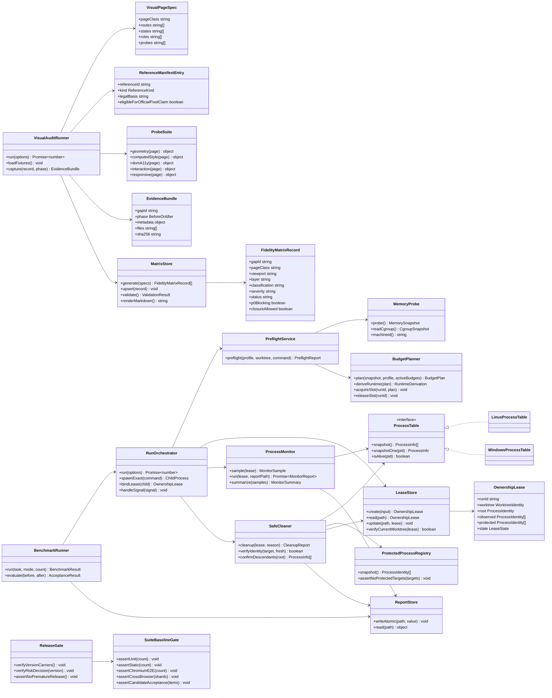
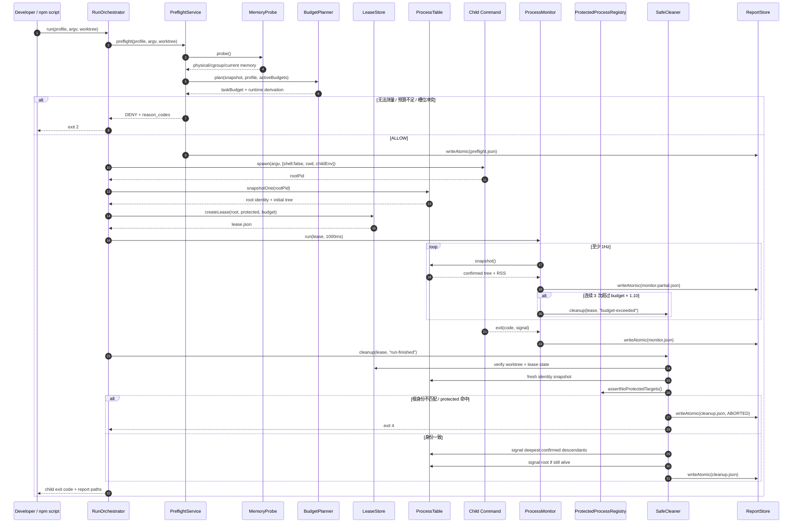
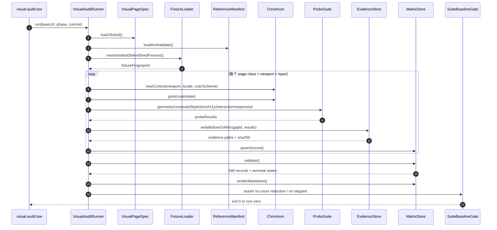
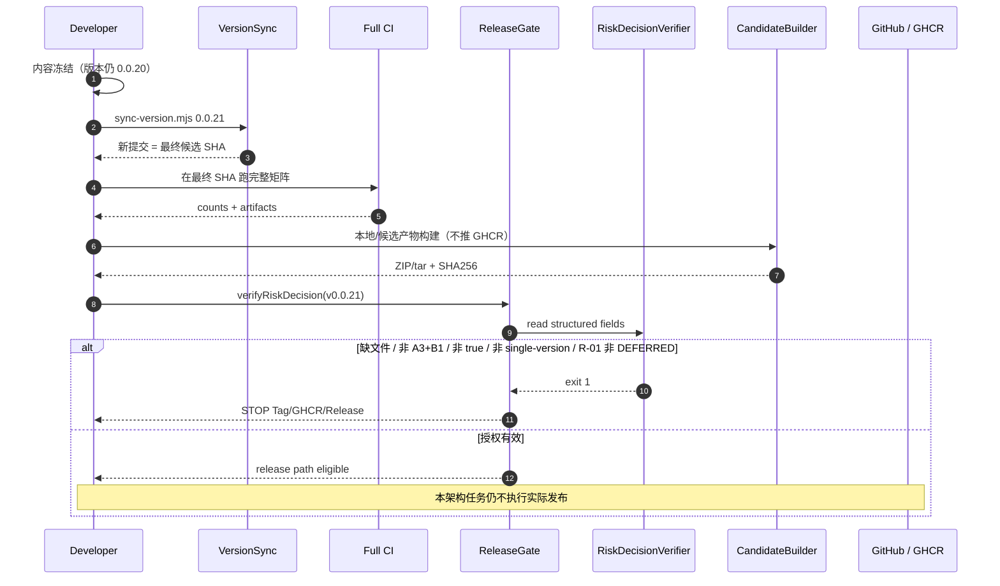
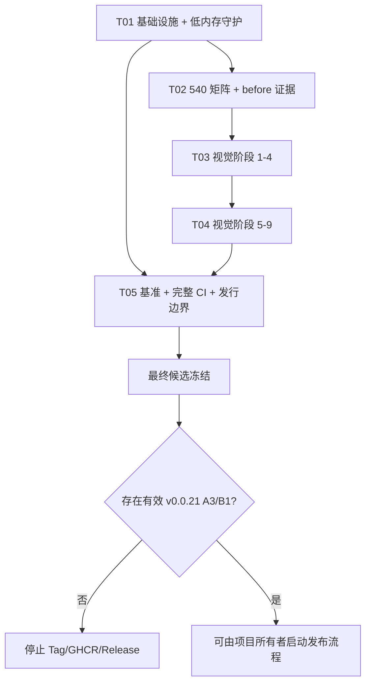

# ARCHITECTURE v0.0.21 — V2EX 高保真视觉还原与 WorkBuddy 低内存研发环境

> 状态：架构基线 / 开发候选 / 正式发布 **NO-GO**
> 语言：中文
> 项目：`v2ex_clone`
> 分支：`release/v0.0.21-stable`
> 工作树：`C:/Users/TYMO001/WorkBuddy/ai/_worktrees/v0021-release`
> 起始基线：`origin/master = 872ae726c84d755f81e2b8477f34eeb025cb889b`
> 起始树：`d2041500dfb8c57c49dc211f011626a38b6cdc36`
> 上游需求：`docs/PRD_v0.0.21.md`
> 本文只做架构、接口、证据与任务分解，不实现产品代码。

---

## 0. 已核实事实与硬边界

1. 当前工作树 HEAD 与 `origin/master` 均为 `872ae726c84d755f81e2b8477f34eeb025cb889b`，树均为 `d2041500dfb8c57c49dc211f011626a38b6cdc36`。除上游新增的 `docs/PRD_v0.0.21.md` 外无跟踪改动。
2. 运行时版本载体保持 `0.0.20`：`package.json`、`package-lock.json`、`deploy/VERSION`、`docs/release-facts.json.version`、README 版本锚点及部署文件均不得提前改成 `0.0.21`。
3. v0.0.20 候选下限以 `docs/TEST_REPORT_v0.0.20.md` 与 PRD QA-03 为准：单元 **1122**、静态 **501**、Chromium E2E **296**、跨浏览器 **15 个分片**、候选包四角色 **41 项**。当前 `docs/release-facts.json` 的数字仍属于 v0.0.19 历史快照，不能拿来下调 v0.0.20 下限。
4. 未取得机器可校验的 `docs/RISK_DECISION_v0.0.21.md`（`decision_a=A3`、`decision_b=B1`、`public_release_authorized=true`、`scope=single-version`、`r01_status=DEFERRED`）前：
   - 不创建/推送 `v0.0.21` Tag；
   - 不推送正式 GHCR `:v0.0.21`；
   - 不创建/修改 Release；
   - 不改写历史、不 force push、不移动/删除既有 Tag。
5. R-01 始终 `DEFERRED`；24h 单实例连续运行始终 `not-completed`，除非未来出现真实、单实例、连续 24h 的可复现证据。
6. 本版不引入官方 HTML/CSS/JS、截图或其它受版权保护素材；不宣称“像素完全一致”“视觉还原度 XX%”。

---

# Part A: System Design

## 1. Implementation Approach

### 1.1 总体原则

- **先资源守护，后视觉改造**：任何大规模视觉编译、截图或浏览器矩阵前，先具备可审计的 preflight/monitor/cleanup。
- **同一预算派生全部并发参数**：Node 堆、Vitest worker、Playwright worker、Next build worker 都从一次 preflight 的 `taskBudgetMB` 派生，不各自拍脑袋。
- **只按精确身份终止进程**：进程选择器只能是 lease 中记录的 PID + 启动时间/PPID/可执行文件等身份；绝不用进程名、命令行模糊匹配或端口扫描选择受害者。
- **视觉以证据闭环**：18 类页面 × 5 视口 × 6 层 = 540 条记录；没有 before/after 证据和复测结果不得标 `FIXED/VERIFIED`。
- **不建设大而全 Design System**：现有项目是 Next.js App Router + 全局 CSS，没有 MUI/Tailwind。本版只把全局样式中真实重复的几何、排版、颜色、圆角、阴影、层级和动效抽成少量 tokens。
- **完整 CI 不降级**：低内存入口只服务本机/资源受限环境，不替代、不删除、不跳过任何现有 workflow job 或用例。

### 1.2 低内存资源守护

#### 1.2.1 技术选择

| 挑战 | 选择 | 理由 |
|---|---|---|
| 跨平台进程/内存读取 | Node 22 内置模块：`fs`、`os`、`child_process`、`crypto`；Linux 读 `/proc` 与 cgroup；Windows 调用仓库内固定 `.ps1` 读取 CIM | 不引入原生模块；路径以参数数组传递，天然支持空格；可在当前 Node 22.23.4 上运行 |
| 动态预算 | 单一 `BudgetPlanner`，输出可复算公式与全部输入 | 避免脚本各处写死 MB；preflight JSON 可直接复算 |
| 进程归属 | `OwnershipLease` + `ProtectedProcessRegistry` + 每次终止前二次校验 | 防 PID 复用、防跨 worktree、防误杀 WorkBuddy/Postgres/Redis/无关 Node |
| 监控 | 独立 supervisor 内 1Hz 采样，也提供独立 `monitor.mjs` | 不把监控放进被测 Node 进程，避免被测进程卡死导致监控失效 |
| 报告 | JSON Schema + 原子写入（临时文件 `rename`） | 机器可读、崩溃时不会留下半截 JSON |
| 测试 | Vitest 5 纯函数/解析器单测 + 双平台 workflow 真实子进程安全测试 | 默认 1122 单元套件不引入平台条件 skip；真实清理在专用双平台 job 验证 |

#### 1.2.2 有效内存与动态预算

`MemoryProbe` 输出原始观测值，`BudgetPlanner` 严格按 PRD MEM-02 计算：

```text
effectiveLimitMB = min(physicalMemoryMB, cgroupLimitMB)       # 有有限 cgroup limit 时
hostReserveMB   = max(1024, WORKBUDDY_RESERVE_MB)             # 默认至少 1 GiB
availableMB     = max(0, effectiveLimitMB - hostReserveMB)
taskBudgetMB    = min(userCeilingMB,
                      max(taskFloorMB, availableMB × taskShare))
sum(activeTaskBudgetsMB) + taskBudgetMB + hostReserveMB <= effectiveLimitMB
```

补充的 fail-closed 观测：

- Linux cgroup v2 读 `/sys/fs/cgroup/memory.max`、`memory.current`；v1 读 `/sys/fs/cgroup/memory/memory.limit_in_bytes`、`memory.usage_in_bytes`。`max` 或明显超过物理内存的哨兵值视为“无 cgroup 限制”。
- `currentAvailableMB = min(os.freemem(), cgroupAvailableMB)`；当前可用量低于 `taskFloorMB` 时拒绝启动。
- 所有环境变量必须是有限非负数字；解析失败不静默回退，直接 `DENY`。
- 多 worktree/多任务通过机器级预算槽位串行化；只有 `sum(activeTaskBudgets)+hostReserve <= effectiveLimit` 才发新 lease。槽位文件记录 worktree、run_id、root 身份与预算；owner 进程已消失且身份匹配时才可回收陈旧槽位。
- `--unsafe-override` 只允许绕过“预算低于任务下限”，不允许绕过“无法测量有效内存”“无法建立进程树/lease”“清理身份校验失败”。unsafe 报告必须含 `"unsafe": true` 与 `UNSAFE` 标记。

建议的首版 profile 参数（必须由 T04/T05 的真实基线校准，未校准前只是保守默认）：

| profile | taskShare | taskFloorMB | Node 堆比例 | 派生并发 |
|---|---:|---:|---:|---|
| `next-dev` | 0.40 | 384 | 0.60 | 仅 Node 堆；不伪造 Next 私有参数 |
| `next-build` | 0.55 | 768 | 0.60 | `nextBuildCpus = clamp(floor(taskBudget/512), 1, min(cpuCount,4))` |
| `vitest` | 0.35 | 384 | 0.60 | `maxWorkers=1`、`fileParallelism=false`、`pool=forks` |
| `playwright` | 0.45 | 512 | 0.60 | `workers=1`、`fullyParallel=false` |
| `visual-audit` | 0.45 | 512 | 0.60 | Playwright `workers=1`；浏览器串行上下文 |

派生公式：

```text
nodeMaxOldSpaceMB = max(256, floor(taskBudgetMB × 0.60))
vitestMaxWorkers  = 1
playwrightWorkers = 1
nextBuildCpus     = clamp(floor(taskBudgetMB / 512), 1, min(cpuCount, 4))
```

#### 1.2.3 已安装版本的真实参数边界

实现前已按当前 `package-lock.json` 与已安装包核验：

| 组件 | 实际版本 | 本版使用 | 明确不使用 |
|---|---|---|---|
| Vitest | `5.0.5` | `maxWorkers?: number\|string`、`fileParallelism?: boolean`（false 会把 maxWorkers 覆盖为 1）、`pool?: 'threads'\|'forks'\|'vmThreads'\|'vmForks'` | 不使用当前类型中未暴露的 `poolOptions` |
| Playwright | `1.64.1` | `workers?: number\|string`、`fullyParallel?: boolean`；CLI `--workers`、`--fully-parallel` | 不提高 worker 数，不跳例 |
| Next.js | `15.5.29` | `experimental.cpus`、`experimental.memoryBasedWorkersCount` 均存在；本版只用 `experimental.cpus` | 不使用不存在的 `maxWorkers`/`buildConcurrency`；不使用 Next 内部 `NEXT_PRIVATE_BUILD_WORKER` 作为常规低内存方案 |
| Node | `>=22.23.4`（当前执行器 22.22.2，CI 指定 22.23.4） | 子进程级 `NODE_OPTIONS=--max-old-space-size=<derived>` | 不写用户/系统/全局 `NODE_OPTIONS` |

Next 配置只接受一个受控环境变量：

```js
const cpus = Number(process.env.WORKBUDDY_NEXT_CPUS);
experimental: Number.isInteger(cpus) && cpus > 0 ? { cpus } : undefined
```

`memoryBasedWorkersCount` 虽然受支持，但其当前实现有最低 4 worker 行为，不适合低内存目标，因此不启用。

#### 1.2.4 进程归属令牌与 fencing

每个 run 生成不可猜测的 `run_id`，lease 至少包含：

- `worktree_root` 的 realpath、`git_head`、`git_tree`、分支；
- 精确命令 argv、cwd、环境变量哈希（不保存秘密值）；
- 根进程 `pid`、`ppid`、start time、可执行文件 realpath、身份哈希；
- 已观察后代 PID 集合及每个进程的身份快照；
- preflight 生成的 protected PID 集合；
- 创建时间、预算、profile、状态与报告路径。

Linux 身份来自 `/proc/<pid>/stat`（start ticks + PPID）、`/proc/<pid>/cwd`、`/proc/<pid>/exe`；Windows 身份来自 CIM `ProcessId`、`ParentProcessId`、`CreationDate`、`ExecutablePath`，根 cwd 使用 supervisor 启动时捕获的权威 cwd（Windows 标准 API 不提供任意进程 cwd）。

二次校验规则：

1. lease 必须属于当前 worktree；跨 worktree cleanup 直接 `ABORTED`。
2. 根 PID 必须仍存在且 start time/PPID/可执行文件与 lease 一致；不一致视为 PID 复用，绝不发送信号。
3. 后代必须能在**当前**进程表中沿 PPID 链追溯到根，且 start time 不早于 lease 创建时间。
4. protected 集合命中任何目标时，整体放弃清理并报告；不会“跳过受保护进程但继续杀其它进程”。
5. 终止顺序为最深后代到根，每次发送信号前重新读取身份；不发送 `/T`、不按映像名、不按端口、不按命令行。
6. 清理只发信号，不删除日志、报告、测试结果、数据库或用户数据。

#### 1.2.5 preflight / monitor / cleanup 入口

三个入口都可独立调用，也由 `run.mjs` 串起来：

```bash
node tools/dev-memory/preflight.mjs --profile next-build --worktree . --json <path>
node tools/dev-memory/monitor.mjs --lease <lease.json> --report <monitor.json>
node tools/dev-memory/cleanup.mjs --lease <lease.json> --report <cleanup.json>
```

`monitor.mjs` 默认 1000ms 采样；启动时立即采第一帧，之后任意相邻采样的单调时间间隔不得超过 1000ms，否则记为监控失败。`run.mjs` 在监控失败时尝试安全清理并返回非零，不静默继续。

### 1.3 视觉审计与改造

#### 1.3.1 现有前端事实

- 入口：`src/app/layout.tsx`；全局唯一样式表：`src/app/globals.css`（2052 行）；首页：`src/app/page.tsx`。
- 主题机制：`layout.tsx` 内联 bootstrap 写 `data-theme`/`data-effective-theme`；`ThemeToggle.tsx` 提供 Light/Dark/System；dark overrides 集中在 `globals.css` 尾部。
- 布局：`Wrapper.tsx` + `#Top`/`#Wrapper`/`#Main`/`#Rightbar`；桌面几何由 `globals.css` 控制，移动端只有媒体查询，没有独立移动端样式文件。
- 导航：`SiteNav.tsx`、`Logo.tsx`、`SearchBox.tsx`、`NavTools.tsx`、`Footer.tsx`、`src/lib/nav-links.ts`。
- 右栏：`HotTopics.tsx`、`HotNodes.tsx`、`SiteOfTheDay.tsx`，以及各页面内联的 rightbar JSX。
- 主题列表：`TopicItem.tsx`、`PageNav.tsx`、`Pager.tsx`；首页/`recent`/`hot`/`following`/`tag`/`member` 大量复用。
- 主题详情与七种回复：`src/app/t/[id]/page.tsx`、`ReplyList.tsx`、`ReplyItem.tsx`、`ReplyComposer.tsx`、`TopicActions.tsx`、`TopicEditForm.tsx`；七模式 `classic/quote/badge/nested/tree/lines/excerpt` 全部在 `ReplyList.tsx`，样式在 `globals.css` 的 v0.0.19 回复区。
- 现有视觉工具：`tools/visual/regression.mjs`、`probe-pages.mjs`、`measure-page-geometry.mjs`、`audit-pages.mjs`、`audit-four-roles.mjs`、`lib/page-health.mjs`。它们只覆盖 3 个核心页/7 个旧视口，不能直接充当 540 条矩阵。

#### 1.3.2 不新建 Design System，只抽真实重复 tokens

新增 `src/app/tokens.css`，由 `layout.tsx` 在 `globals.css` 前导入。只收集中出现 3 次以上、且跨组件共享的值：

- 布局：顶栏高度、内容最大宽、主栏/右栏宽、栏间距、页面边距；
- 排版：12/13/14/15/16/22px 与 120/130/150/160/200% 行高；
- 颜色：画布灰、卡片白、正文/石墨/灰/淡灰、链接蓝灰、焦点蓝、错误色；
- 形状：3px 圆角、1px 边框、两组 box-shadow；
- 层级：搜索下拉、模态、移动端悬浮控件、图片预览、toast；
- 动效：150/200/300ms 与 reduced-motion 约定。

迁移策略：

1. 先加 tokens，保持计算值完全不变；
2. 只替换 `globals.css` 中可证明等值的字面量；
3. 组件内静态 inline style 迁到 class/token，动态值保留 inline；
4. dark 只覆盖颜色/阴影 token，不改几何；
5. 每阶段用 before/after computed-style 证据证明未引入意外变化。

不得引入 MUI、Tailwind 或新组件库；现有信息架构和全局 CSS 方案不变。

#### 1.3.3 540 条矩阵生成与存储

- 规范定义：`tools/visual/v021/spec.mjs`，18 个 page class、5 个视口、6 层、状态/角色/路由/探针。
- 生成：`generate-matrix.mjs` 确定性生成 540 个 `gap_id`，不允许手工编号。
- 机器可读：`docs/evidence/visual/v0.0.21/fidelity-matrix.json`。
- 人读交付：`docs/VISUAL_FIDELITY_MATRIX_v0.0.21.md`，包含 540 行索引、汇总、UNVERIFIED 原因与证据链接。
- 校验：`validate-matrix.mjs` 检查数量、唯一终态、必填字段、证据路径、P0 阻断规则。
- 渲染：`render-matrix.mjs` 只从 JSON 生成 MD，避免两份数据漂移。

`gap_id` 示例：`V21-P06-VP390-L5-R07`（页面类 06 / 视口 / 层 / 该层第 7 个差距）。每条记录保留 PRD 要求的全部字段，并增加 `states[]`、`probe_results[]`、`p0_blocking`、`closure_allowed`。

参考清单 `docs/evidence/visual/v0.0.21/reference-manifest.json` 字段：

```json
{
  "reference_id": "SELF-V020-BASELINE",
  "kind": "project-owned-baseline",
  "url_or_path": "docs/evidence/visual/v0.0.21/before/...",
  "captured_at": "2026-11-22T00:00:00.000Z",
  "legal_basis": "project-owned source and screenshot; regression only",
  "auth_role": "guest",
  "viewport": "1280x900",
  "dpr": 1,
  "locale": "zh-CN",
  "sha256": "...",
  "eligible_for_official_pixel_claim": false
}
```

合法参考只有三类：

1. `project-owned-baseline`：只能证明自身回归，不能证明与官方一致；
2. `public-interaction-contract`：公开帮助文档/公开行为确认的交互契约，不复制素材；
3. `none`：参考不足，相关记录必须 `UNVERIFIED`。

任何 P0 记录标 `UNVERIFIED` 时 `p0_blocking=true`、`closure_allowed=false`，候选不得据此宣称 P0 已关闭；必须由项目所有者提供合法参考或明确调整范围。

#### 1.3.4 探针与确定性数据

| 层 | 探针 | 主要输出 |
|---|---|---|
| L1 | reference eligibility | manifest、来源、时间、登录态、视口、DPR、locale、哈希 |
| L2 | geometry | 顶栏/容器/主栏/右栏/卡片/列表/分页/表单的 x/y/w/h、间距、重叠、溢出 |
| L3 | computed style | 字体、字号、字重、行高、颜色、背景、边框、圆角、阴影、图标尺寸 |
| L4 | DOM/ARIA | 选择器契约、地标、标题、表单标签、空节点、嵌套、DOM 顺序、`ariaSnapshot()` |
| L5 | interaction/a11y | hover/focus/active/disabled/loading/error/empty、键盘、触控、ARIA、对比度、reduced-motion |
| L6 | responsive/robustness | 5 视口、200% 缩放、长字符串、0/1/多数据、图片缺失、Dark/System、横向溢出 |

确定性要求：

- 固定 `SEED_TIME_ANCHOR=2026-11-06T04:00:00.000Z` 与 `APP_NOW`；
- 独立审计数据库，每次 run 前重建并校验 fixture 指纹；
- 固定 locale `zh-CN`、浏览器版本、DPR、主题和时钟；
- 网络静默、字体就绪、连续两次布局快照一致后才采样；
- 长标题/长正文/无回复/锁定态/0/1/多数据/缺失图片均由 `fixtures.mjs` 写入隔离库；
- Chromium 的 200% 缩放使用 CDP `Emulation.setPageScaleFactor`，并在证据中记录方法；其它引擎不把 CSS `zoom` 冒充真实浏览器缩放。

证据组织：

```text
docs/evidence/visual/v0.0.21/
  reference-manifest.json
  fidelity-matrix.json
  before/<gap_id>/{metadata.json,geometry.json,styles.json,dom-aria.json,interaction.json,*.png}
  after/<gap_id>/{metadata.json,geometry.json,styles.json,dom-aria.json,interaction.json,*.png}
  runs/<timestamp>/{environment.json,raw-probes.json,console-errors.json}
```

原始 JSON 与关键 before/after PNG 入仓；大 trace 上传 CI artifact，并在 metadata 记录 artifact 名称与 SHA256。任何证据文件都不允许被清理入口删除。

`visual:audit:low` 默认使用 `run-audit.mjs --managed-server`：审计器在顶层 lease 的进程树内以 `shell:false` 启动 `next start`，等待 HTTP 200 后执行矩阵，结束时先按精确 PID 停止服务器，再由 `run.mjs` 做最终树校验与清理。这样监控覆盖 Next 服务器、Node 审计器、Playwright 与浏览器后代。若显式传 `--base-url` 使用外部服务器，monitor 报告必须标 `scope=audit-process-tree-only`，不得把结果冒充全栈内存结论。

### 1.4 质量与发行

- 新增测试只增不减；所有数量门禁使用 v0.0.20 候选下限。
- 低内存工具的正确性测试进入普通 CI；低内存**性能基准**只在固定本机运行，不用 GitHub runner 的内存数字代替 WorkBuddy 本机结论。
- 开发态与生产态内存报告分开；`next dev`/Vitest/Playwright/visual 与 `next build + next start` 不互相替代。
- 每个任务/模式先跑 1 次丢弃的 warm-up，再跑 3 次测量；每次测量前恢复字节一致的 fixture（数据库快照、warm cache、环境变量集合），模式间等待进程树清空并记录冷却时间。`before` 使用标准入口，`after` 使用对应 low 入口；唯一有意的变量是资源参数，其余条件必须相同。
- 候选内容冻结后再同步 `0.0.21`，形成新的最终候选 SHA，并在该 SHA 重跑完整门禁。
- A3/B1 缺失时，版本同步、候选构建、只读发布预演可以继续；Tag/GHCR/Release 必须停止。
- 授权校验必须调用现有 `scripts/release/verify-risk-decision.mjs --version v0.0.21`，不能只 grep 关键字。除 PRD 列出的字段外，该脚本还要求 `schema`、版本匹配、`one_time=true`、非自动化 `authorized_by`、合法 `authorized_at`，以及完整的允许/禁止操作清单；任一不满足都停止发行。

---

## 2. File List

### 2.1 低内存资源守护（新增）

| 文件 | 作用 |
|---|---|
| `tools/dev-memory/preflight.mjs` | preflight CLI |
| `tools/dev-memory/monitor.mjs` | 独立监控 CLI |
| `tools/dev-memory/cleanup.mjs` | 安全清理 CLI |
| `tools/dev-memory/run.mjs` | preflight → spawn → bind lease → monitor → cleanup 的 supervisor |
| `tools/dev-memory/benchmark.mjs` | before/after 各 3 次同条件基准与验收公式 |
| `tools/dev-memory/profiles.mjs` | profile share/floor/派生参数 |
| `tools/dev-memory/cli-args.mjs` | 无 shell 的参数解析 |
| `tools/dev-memory/report-store.mjs` | 原子 JSON 报告读写 |
| `tools/dev-memory/lib/memory-probe.mjs` | 物理内存、cgroup、当前可用量 |
| `tools/dev-memory/lib/budget-planner.mjs` | MEM-02 公式与多任务槽位 |
| `tools/dev-memory/lib/process-table.mjs` | 跨平台进程表门面 |
| `tools/dev-memory/lib/process-table-linux.mjs` | `/proc` 解析、RSS、cwd/exe |
| `tools/dev-memory/lib/process-table-windows.mjs` | CIM/PowerShell JSON 解析、WorkingSet |
| `tools/dev-memory/lib/process-table.ps1` | Windows 固定进程表查询脚本 |
| `tools/dev-memory/lib/ownership-lease.mjs` | lease 创建、身份哈希、fencing |
| `tools/dev-memory/lib/protected-registry.mjs` | WorkBuddy/编辑器/Postgres/Redis/祖先保护集 |
| `tools/dev-memory/lib/safe-cleaner.mjs` | 精确 PID、深度优先、二次校验 |
| `tools/dev-memory/lib/monitor-core.mjs` | 1Hz 采样、峰值/P95/超预算判定 |
| `tools/dev-memory/lib/worktree.mjs` | realpath、git HEAD/tree、机器标识 |
| `tools/dev-memory/schemas/preflight.schema.json` | preflight 报告 schema |
| `tools/dev-memory/schemas/lease.schema.json` | ownership lease schema |
| `tools/dev-memory/schemas/monitor.schema.json` | monitor 报告 schema |
| `tools/dev-memory/schemas/cleanup.schema.json` | cleanup 报告 schema |
| `tools/dev-memory/schemas/benchmark.schema.json` | before/after 基准 schema |
| `tests/dev-memory/budget.spec.ts` | 公式、fail-closed、unsafe 标记 |
| `tests/dev-memory/process-table-parsers.spec.ts` | Linux/Windows 解析器固定样本 |
| `tests/dev-memory/lease-fencing.spec.ts` | PID 复用、跨 worktree、路径空格 |
| `tests/dev-memory/monitor-math.spec.ts` | 峰值、P95、wall-clock、采样间隔 |
| `tests/dev-memory/cleanup-safety.spec.ts` | 树外探针存活、后代终止、证据不删 |
| `tests/static/v021-dev-memory-guards.spec.ts` | 禁止宽泛 kill、禁止全局 NODE_OPTIONS、入口存在性 |
| `.github/workflows/dev-memory.yml` | Windows/Linux 双平台工具与真实清理安全测试 |
| `docs/DEV_MEMORY_v0.0.21.md` | 使用方式、公式、报告字段与限制 |

### 2.2 低内存集成（修改）

| 文件 | 修改 |
|---|---|
| `package.json` | 增加 `memory:*` 与 `build:low`/`test:unit:low`/`test:e2e:low`/`visual:audit:low`，可选 `dev:low` |
| `next.config.mjs` | 仅从 `WORKBUDDY_NEXT_CPUS` 派生受支持的 `experimental.cpus` |
| `vitest.low.config.ts` | 合并现有配置，强制 `pool=forks`、`maxWorkers=1`、`fileParallelism=false` |
| `playwright.low.config.ts` | 合并现有配置，强制 `workers=1`、`fullyParallel=false`，不改 testIgnore |

`package.json` 的目标集成形态如下；所有预算参数由 `run.mjs` 在**子进程环境**中注入，父 shell、用户配置和系统配置中的 `NODE_OPTIONS` 均不被永久修改：

```json
{
  "scripts": {
    "memory:preflight": "node tools/dev-memory/preflight.mjs",
    "memory:monitor": "node tools/dev-memory/monitor.mjs",
    "memory:cleanup": "node tools/dev-memory/cleanup.mjs",
    "dev:low": "node tools/dev-memory/run.mjs --profile next-dev -- npm run dev",
    "build:low": "node tools/dev-memory/run.mjs --profile next-build -- npm run build",
    "test:unit:low": "node tools/dev-memory/run.mjs --profile vitest -- npx vitest run --config vitest.low.config.ts",
    "test:e2e:low": "node tools/dev-memory/run.mjs --profile playwright -- npx playwright test --config playwright.low.config.ts",
    "visual:audit:low": "node tools/dev-memory/run.mjs --profile visual-audit -- node tools/visual/v021/run-audit.mjs --managed-server"
  }
}
```

### 2.3 视觉审计系统（新增）

| 文件 | 作用 |
|---|---|
| `tools/visual/v021/spec.mjs` | 18×5×6 规范、状态、角色、探针映射 |
| `tools/visual/v021/generate-matrix.mjs` | 生成 540 个唯一记录 |
| `tools/visual/v021/validate-matrix.mjs` | 终态、必填、证据、P0 阻断校验 |
| `tools/visual/v021/render-matrix.mjs` | 从 JSON 渲染 MD |
| `tools/visual/v021/fixtures.mjs` | 隔离审计库与 0/1/多/长内容/缺失图片 fixture |
| `tools/visual/v021/browser-probes.mjs` | L2–L6 浏览器探针 |
| `tools/visual/v021/evidence-store.mjs` | before/after 证据与哈希 |
| `tools/visual/v021/run-audit.mjs` | 完整审计编排 |
| `tools/visual/v021/matrix.schema.json` | 矩阵记录 schema |
| `docs/VISUAL_FIDELITY_MATRIX_v0.0.21.md` | 540 条人读矩阵 |
| `docs/evidence/visual/v0.0.21/reference-manifest.json` | 合法参考清单 |
| `docs/evidence/visual/v0.0.21/fidelity-matrix.json` | 机器可读矩阵 |
| `tests/static/v021-visual-matrix.spec.ts` | 540 条完整性/状态/证据静态门禁 |
| `e2e/v021-visual-contract.spec.ts` | 无溢出、无 hydration/page/console error、交互与焦点契约 |

### 2.4 视觉改造（修改，按九阶段）

| 文件/组 | 阶段 |
|---|---|
| `src/app/tokens.css`、`src/app/layout.tsx`、`src/app/globals.css` | 1–9 公共基础 |
| `src/app/page.tsx`、`src/components/TopicItem.tsx`、`PageNav.tsx` | 1 首页 |
| `src/app/recent/page.tsx`、`hot/page.tsx`、`following/page.tsx`、`tag/[name]/page.tsx`、`Pager.tsx` | 2 主题列表 |
| `HotTopics.tsx`、`HotNodes.tsx`、`SiteOfTheDay.tsx`、`Wrapper.tsx`、各页 rightbar JSX | 3 右侧栏 |
| `SiteNav.tsx`、`NavTools.tsx`、`SearchBox.tsx`、`Logo.tsx`、`Footer.tsx`、`src/lib/nav-links.ts` | 4 导航 |
| `src/app/t/[id]/page.tsx`、`ReplyList.tsx`、`ReplyItem.tsx`、`ReplyComposer.tsx`、`TopicActions.tsx`、`TopicEditForm.tsx` | 5 主题详情/七回复 |
| `src/app/member/[username]/page.tsx`、`Avatar.tsx`、`FollowButton.tsx` | 6 用户页 |
| `signin/signup/forgot/reset-password/settings` 页面与 `SignInForm`、`SignUpForm`、`ForgotPasswordForm`、`SettingsForm` | 7 登录与设置 |
| `globals.css` 媒体查询、`Wrapper.tsx`、`SiteNav.tsx`、移动端覆盖组件 | 8 移动端 |
| `ThemeToggle.tsx`、`ReplyList.tsx`、按钮/链接/表单焦点态、`globals.css` 动效区 | 9 微交互 |

### 2.5 质量与发行（修改/新增）

| 文件 | 修改 |
|---|---|
| `scripts/ci/baseline-v0.0.20.json` | 1122/501/296/15/41 单一下限事实源 |
| `scripts/ci/assert-test-counts.mjs` | 支持从基线文件读取下限 |
| `scripts/ci/assert-e2e-counts.mjs` | Chromium E2E 数量与 0 skipped/failed |
| `scripts/ci/assert-cross-browser-shards.mjs` | 15/15 分片、无 not run/skipped |
| `scripts/ci/assert-candidate-acceptance.mjs` | 候选包四角色 ≥41、0 FAIL |
| `.github/workflows/ci.yml` | 单元/静态下限、Chromium JSON 与数量门禁 |
| `.github/workflows/e2e-matrix.yml` | 保留 15 分片与严格汇总 |
| `.github/workflows/visual-regression.yml` | 挂接 v0.0.21 矩阵/证据校验，不自动更新基线 |
| `.github/workflows/candidate-acceptance.yml` | 41 项下限 |
| `.github/workflows/release.yml` | 候选冻结前加入 `v0.0.21` Tag 白名单；不构成发布授权 |
| `tests/static/v021-release-boundary.spec.ts` | 版本载体、A3/B1 停止边界、24h/R-01 措辞 |
| `docs/CANDIDATE_FREEZE_v0.0.21.md` | 最终候选 SHA、CI run、产物哈希 |
| `docs/FINAL_GO_NO_GO_v0.0.21.md` | 最终结论；未授权时明确 No-Go |

### 2.6 现有前端文件清单（审计基线）

| 区域 | 实际文件 |
|---|---|
| 入口/全局 | `src/app/layout.tsx`、`src/app/globals.css`、`src/app/icon.svg` |
| 首页/列表 | `src/app/page.tsx`、`recent/page.tsx`、`hot/page.tsx`、`following/page.tsx`、`tag/[name]/page.tsx` |
| 节点 | `src/app/nodes/page.tsx`、`go/[name]/page.tsx`、`src/components/NodeHeader.tsx` |
| 主题详情 | `src/app/t/[id]/page.tsx` |
| 七回复 | `src/components/ReplyList.tsx`、`ReplyItem.tsx`、`ReplyComposer.tsx`、`TopicActions.tsx`、`TopicEditForm.tsx` |
| 用户/认证/设置 | `member/[username]/page.tsx`、`signin/page.tsx`、`signup/page.tsx`、`forgot/page.tsx`、`reset-password/page.tsx`、`settings/page.tsx` 及对应表单组件 |
| 通知/收藏/搜索 | `notifications/page.tsx`、`bookmarks/page.tsx`、`go/search/page.tsx`、`NotificationsList.tsx`、`SearchBox.tsx` |
| 管理/榜单 | `admin/page.tsx`、`reports/page.tsx`、`leaderboard/page.tsx`、`AdminConsole.tsx` |
| 静态/发布 | `about/page.tsx`、`faq/page.tsx`、`privacy/page.tsx`、`worldclock/page.tsx`、`xna/page.tsx`、`nodes/request/page.tsx`、`go/new/page.tsx`、`StaticPage.tsx`、`NewTopicForm.tsx`、`NodeRequestForm.tsx` |
| 全局导航/右栏 | `Wrapper.tsx`、`SiteNav.tsx`、`NavTools.tsx`、`Logo.tsx`、`SearchBox.tsx`、`Footer.tsx`、`HotTopics.tsx`、`HotNodes.tsx`、`SiteOfTheDay.tsx`、`ThemeToggle.tsx` |
| 移动端 | 仅 `src/app/globals.css` 的 `@media` 规则；无独立移动端 CSS/页面 |

---

## 3. Data Structures and Interfaces

### 3.1 类图



独立文件：`docs/class-diagram.mermaid`。

### 3.2 JSON Schema（规范性摘要）

#### 3.2.1 preflight 报告

```json
{
  "$schema": "https://json-schema.org/draft/2020-12/schema",
  "$id": "workbuddy-dev-memory/preflight/v1",
  "type": "object",
  "required": ["schema", "run_id", "decision", "unsafe", "profile", "measured_at", "machine", "worktree", "limits", "plan", "command"],
  "properties": {
    "schema": { "const": "workbuddy-dev-memory/preflight/v1" },
    "run_id": { "type": "string", "minLength": 16 },
    "decision": { "enum": ["ALLOW", "ALLOW_UNSAFE", "DENY"] },
    "unsafe": { "type": "boolean" },
    "reason_codes": { "type": "array", "items": { "type": "string" } },
    "profile": { "enum": ["next-dev", "next-build", "vitest", "playwright", "visual-audit"] },
    "machine": {
      "type": "object",
      "required": ["id", "platform", "arch", "node_version", "cpu_count"],
      "properties": {
        "id": { "type": "string" },
        "platform": { "enum": ["win32", "linux"] },
        "arch": { "type": "string" },
        "node_version": { "type": "string" },
        "cpu_count": { "type": "integer", "minimum": 1 }
      }
    },
    "worktree": {
      "type": "object",
      "required": ["root", "git_head", "git_tree", "branch"],
      "properties": {
        "root": { "type": "string" },
        "git_head": { "type": "string", "pattern": "^[0-9a-f]{40}$" },
        "git_tree": { "type": "string", "pattern": "^[0-9a-f]{40}$" },
        "branch": { "type": "string" }
      }
    },
    "limits": {
      "type": "object",
      "required": ["physical_mb", "cgroup", "effective_limit_mb", "host_reserve_mb", "available_mb", "current_available_mb", "user_ceiling_mb"],
      "properties": {
        "physical_mb": { "type": "integer", "minimum": 0 },
        "cgroup": { "type": ["object", "null"] },
        "effective_limit_mb": { "type": "integer", "minimum": 0 },
        "host_reserve_mb": { "type": "integer", "minimum": 1024 },
        "available_mb": { "type": "integer", "minimum": 0 },
        "current_available_mb": { "type": "integer", "minimum": 0 },
        "user_ceiling_mb": { "type": ["integer", "null"], "minimum": 1 }
      }
    },
    "plan": {
      "type": "object",
      "required": ["task_floor_mb", "task_share", "active_budgets_mb", "task_budget_mb", "sum_task_budgets_plus_reserve_mb", "runtime"],
      "properties": {
        "task_floor_mb": { "type": "integer", "minimum": 1 },
        "task_share": { "type": "number", "exclusiveMinimum": 0, "maximum": 1 },
        "active_budgets_mb": { "type": "integer", "minimum": 0 },
        "task_budget_mb": { "type": "integer", "minimum": 1 },
        "sum_task_budgets_plus_reserve_mb": { "type": "integer", "minimum": 1 },
        "runtime": { "type": "object" }
      }
    },
    "command": {
      "type": "object",
      "required": ["argv", "cwd", "env_fingerprint"],
      "properties": {
        "argv": { "type": "array", "items": { "type": "string" }, "minItems": 1 },
        "cwd": { "type": "string" },
        "env_fingerprint": { "type": "string" }
      }
    }
  }
}
```

`plan.runtime` 必含：

```json
{
  "node_max_old_space_mb": 460,
  "vitest_max_workers": 1,
  "vitest_file_parallelism": false,
  "vitest_pool": "forks",
  "playwright_workers": 1,
  "playwright_fully_parallel": false,
  "next_build_cpus": 1
}
```

#### 3.2.2 ownership lease

```json
{
  "schema": "workbuddy-dev-memory/lease/v1",
  "run_id": "…",
  "created_at": "2026-11-22T00:00:00.000Z",
  "state": "ACTIVE",
  "profile": "next-build",
  "worktree": { "root": "…", "git_head": "…", "git_tree": "…", "branch": "release/v0.0.21-stable" },
  "command": { "argv": ["npm", "run", "build"], "cwd": "…", "env_fingerprint": "…" },
  "budget_mb": 1024,
  "root": {
    "pid": 12345,
    "ppid": 12344,
    "start_time": "2026-11-22T00:00:00.000Z",
    "start_ticks": 12345678,
    "exe": "C:\\…\\node.exe",
    "identity_hash": "sha256:…"
  },
  "observed": [],
  "protected": [],
  "fence": { "worktree_hash": "…", "created_monotonic_ns": "…" }
}
```

`start_ticks` 在 Linux 使用，Windows 可为 `null`；但 Windows `start_time` 必填。任何身份字段不匹配即 `IDENTITY_MISMATCH`。

#### 3.2.3 monitor 报告

```json
{
  "schema": "workbuddy-dev-memory/monitor/v1",
  "run_id": "…",
  "started_at": "…",
  "ended_at": "…",
  "interval_ms": 1000,
  "samples": [
    {
      "at": "…",
      "elapsed_ms": 1000,
      "processes": [
        { "pid": 12345, "ppid": 12344, "name": "node", "rss_mb": 210.4, "start_time": "…" }
      ],
      "tree_rss_mb": 420.8,
      "max_process_rss_mb": 210.4
    }
  ],
  "summary": {
    "root_pid": 12345,
    "peak_tree_rss_mb": 888.1,
    "peak_process_rss_mb": 501.2,
    "p95_tree_rss_mb": 802.6,
    "sample_count": 90,
    "wall_clock_ms": 90120,
    "exit_code": 0,
    "signal": null,
    "commit": "…",
    "profile": "next-build",
    "machine_id": "…",
    "monitor_errors": []
  }
}
```

P95 使用 nearest-rank：对 `tree_rss_mb` 升序后取索引 `ceil(0.95*n)-1`。共享页会按各进程 RSS 相加，可能重复计算共享内存；报告必须保留这一口径，不把它称为 PSS。

#### 3.2.4 cleanup 报告

```json
{
  "schema": "workbuddy-dev-memory/cleanup/v1",
  "run_id": "…",
  "decision": "CLEANED",
  "reason": "budget-exceeded",
  "root_verification": { "ok": true, "pid": 12345, "identity_hash": "…" },
  "targets": [
    { "pid": 12346, "identity_ok": true, "signal": "SIGTERM", "result": "exited", "verified_at": "…" }
  ],
  "skipped": [],
  "outside_probe": { "pid": 12400, "alive": true },
  "protected_intact": true,
  "artifacts_intact": true,
  "errors": []
}
```

`decision` 枚举：`NOOP`、`CLEANED`、`ABORTED`。`ABORTED` 必须非零退出。

#### 3.2.5 benchmark 报告

```json
{
  "schema": "workbuddy-dev-memory/benchmark/v1",
  "task": "next-build",
  "environment": {
    "commit": "…", "tree": "…", "dependency_lock_sha256": "…", "node_version": "22.23.4",
    "machine_id": "…", "db_fixture_sha256": "…", "warmup_id": "…", "env_fingerprint": "…"
  },
  "before": { "mode": "standard", "samples": [] },
  "after": { "mode": "low", "samples": [] },
  "aggregate": {
    "before_peak_median_mb": 0,
    "after_peak_max_mb": 0,
    "before_wall_median_ms": 0,
    "after_wall_max_ms": 0
  },
  "acceptance": {
    "peak_pass": false,
    "wall_pass": false,
    "tests_pass": false,
    "formula": "afterPeakMax < beforePeakMedian && afterWallMax <= beforeWallMedian*1.3+30000 && testsPass",
    "conclusion": "not-completed"
  }
}
```

#### 3.2.6 矩阵记录与参考清单

矩阵记录必填 PRD 字段：

```json
{
  "gap_id": "V21-P06-VP390-L5-R07",
  "page_class": "主题详情",
  "route": "/t/[id]",
  "auth_role": "user",
  "viewport": "390x844",
  "layer": "L5",
  "reference_id": "PUBLIC-INTERACTION-CONTRACT-001",
  "reference_url_or_path": "…",
  "captured_at": "…",
  "legal_basis": "public interaction contract; no copied assets",
  "baseline_selector": ".reply-card",
  "baseline_value": {},
  "current_selector": ".reply-card",
  "current_value": {},
  "delta": {},
  "classification": "A",
  "severity": "P0",
  "status": "OPEN",
  "evidence_before": "…",
  "evidence_after": null,
  "owner": "frontend",
  "commit": "…",
  "retest_result": null,
  "notes": "…",
  "states": ["long-title", "long-body", "no-reply", "locked"],
  "probe_results": [],
  "p0_blocking": true,
  "closure_allowed": false
}
```

状态机：

```text
OPEN → FIXED → VERIFIED
OPEN → INTENTIONAL_DIFFERENCE   # 需理由与批准
OPEN → UNVERIFIED               # 仅参考确实不足；P0 仍阻断
OPEN → WAIVED                   # 需项目所有者显式豁免
```

### 3.3 CLI/API 契约

| 入口 | 必填参数 | 成功退出码 | 失败退出码 |
|---|---|---:|---:|
| `preflight.mjs` | `--profile`、`--worktree`、`--json` | 0（ALLOW/ALLOW_UNSAFE） | 2（DENY/测量失败） |
| `monitor.mjs` | `--lease`、`--report` | 0（监控完成且根退出） | 3（采样/身份/报告失败） |
| `cleanup.mjs` | `--lease`、`--report` | 0（NOOP/CLEANED） | 4（ABORTED/身份不确定） |
| `run.mjs` | `--profile`、`--json-dir`、`--` + 精确 argv | 子进程退出码（0–255） | 2/3/4 或子进程码 |
| `benchmark.mjs` | `--task`、`--mode`、`--runs 3`、`--json` | 0 | 5（验收未通过/数据不完整） |

所有 JSON 写到指定文件；stdout 只输出最终 JSON 摘要或供人读摘要，子进程原始输出写到同目录 `command.log`，避免破坏机器可读通道。

---

## 4. Program Call Flow

### 4.1 低内存运行主流程



独立 `monitor.mjs` 复用同一 `ProcessMonitor`；独立 `cleanup.mjs` 复用同一 `SafeCleaner`，但没有有效 lease 时一律拒绝。

### 4.2 视觉矩阵采集流程



### 4.3 版本冻结与发行边界



### 4.4 关键对象生命周期

- **PreflightReport**：每次命令执行前创建；只读快照。
- **OwnershipLease**：spawn 后创建，monitor/cleanup 读取，状态从 `ACTIVE` → `FINISHED`/`ABORTED`。
- **MonitorReport**：运行中局部原子更新，根退出后终结。
- **CleanupReport**：每次 run 结束、超预算、监控失败或手动 cleanup 时创建。
- **FidelityMatrixRecord**：审计前生成 540 条 `OPEN` 骨架；审计/修复后按状态机更新；`FIXED/VERIFIED` 必须同时有 before/after/retest。
- **ReferenceManifestEntry**：只在合法参考变化时新增；不覆盖历史条目。

---

## 5. Anything UNCLEAR / Assumptions

1. **profile 具体份额与安全下限**：PRD 只给公式，不给各任务 floor/share。本文给保守默认，必须用 T04 的真实基线校准；校准前不得宣称“支持 X MB 机器”。
2. **Windows 进程 cwd**：标准 Windows API 不能稳定读取任意进程 cwd。架构用 supervisor 捕获的根 cwd + PID + CreationDate + PPID + ExecutablePath 做 fencing；若主理人要求 Windows 也强制重新读取 cwd，需要额外决定是否引入受信任原生依赖。
3. **UNVERIFIED 与 P0 的关系**：PRD 要求每条记录有终态，又要求 P0 不得以 UNVERIFIED 结案。本文把“记录可标 UNVERIFIED，但 P0 仍阻断候选”作为默认；需要项目所有者提供合法参考或调整范围，不能伪造像素规格。
4. **200% 缩放口径**：矩阵主审计使用 Chromium CDP `Emulation.setPageScaleFactor`；这不等同于真实操作系统缩放。结论中必须写清方法，不外推到所有引擎。
5. **RSS 口径**：树 RSS 是进程 RSS 之和，会重复计算共享页；不使用 PSS 冒充 RSS。若后续要 PSS，只能新增字段，不能改写历史样本。
6. **before/after 同条件**：同一最终候选 SHA 上比较 `standard` 与 `low` 两种入口；命令族不同是优化变量，其余 commit、依赖锁、数据、环境、机器、warm-up 必须一致并记录哈希。
7. **v0.0.20 数量证据**：`docs/release-facts.json` 仍记录 v0.0.19 的 1086/295，而 v0.0.20 测试报告记录 1122/296。本架构以 v0.0.20 报告和 PRD 为下限；最终必须重跑并产出 v0.0.21 自己的证据。
8. **正式发布授权**：当前不存在 v0.0.21 A3/B1。任何成员不得替项目所有者生成该文件；缺失时停止 Tag/GHCR/Release。
9. **Node 执行器版本**：仓库要求 `node >=22.23.4`，但当前 shell 探针为 `22.22.2`，且该 worktree 尚无 `node_modules`。实现与验收必须切到项目批准的 Node 22.23.4（并安装锁定依赖）后再进行；不得用 22.22.2 的跑动结果冒充门槛证据。

---

# Part B: Task Decomposition

## 6. Required Packages

不新增第三方运行时包。沿用现有：

```text
- next@15.5.29: App Router / build / start
- react@19.3.1 + react-dom@19.3.1: UI
- typescript@6.0.3: 类型检查
- vitest@5.0.5: 单元/静态/工具单测
- @playwright/test@1.64.1: Chromium E2E、跨浏览器、视觉探针
- tsx@4.23.15: 现有 TS 脚本
- sharp@0.35.5: 现有图像几何工具
- pixelmatch@8.0.0 + pngjs@7.0.0: 现有图像差异工具
- drizzle-orm@0.45.4 + drizzle-kit@0.31.11: 审计 fixture 数据库
```

明确不引入：MUI、Tailwind、新 CSS 框架、原生进程库、全局 agent/内存注入库。默认技术栈只有在 PRD 未指定时才采用；本项目已有明确的 Next.js + 全局 CSS 架构，引入 MUI/Tailwind 会增加体积和视觉漂移。

## 7. Task List（最多 5 个）

### T01 — 项目基础设施与低内存守护内核

- **Source Files**：
  - `package.json`、`next.config.mjs`、`vitest.low.config.ts`、`playwright.low.config.ts`
  - `tools/dev-memory/**`
  - `tests/dev-memory/**`、`tests/static/v021-dev-memory-guards.spec.ts`
  - `.github/workflows/dev-memory.yml`
- **Dependencies**：无
- **Priority**：P0
- **内容**：
  1. 实现 preflight/monitor/cleanup/run 四入口与全部 JSON Schema；
  2. 实现 Linux/Windows 进程表、cgroup、ownership lease、protected registry、fencing 与精确 PID 清理；
  3. 集成 `build:low`、`test:unit:low`、`test:e2e:low`、`visual:audit:low`；
  4. 只使用当前版本支持的 Next/Vitest/Playwright 参数，不设全局 `NODE_OPTIONS`；
  5. 双平台安全测试：树外探针存活、后代终止、PID 复用跳过、跨 worktree 拒绝、证据不删。
- **退出条件**：
  - 三个入口各产出合法 JSON；
  - 监控 ≥1Hz，报告含根 PID、完整树、RSS、峰值、P95、wall-clock、退出码、commit、profile、机器标识；
  - 安全测试全部通过，且静态门禁确认新工具无 `taskkill /IM`、`pkill node`、命令行模糊匹配；
  - 无法测量/建立 lease/身份不确定时全部非零退出。

### T02 — 540 条视觉审计矩阵与 before 证据

- **Source Files**：
  - `tools/visual/v021/**`
  - `docs/VISUAL_FIDELITY_MATRIX_v0.0.21.md`
  - `docs/evidence/visual/v0.0.21/reference-manifest.json`
  - `docs/evidence/visual/v0.0.21/fidelity-matrix.json`
  - `docs/evidence/visual/v0.0.21/before/**`
  - `tests/static/v021-visual-matrix.spec.ts`、`e2e/v021-visual-contract.spec.ts`
- **Dependencies**：T01（仅依赖项目基础设施与低内存入口）
- **Priority**：P0
- **内容**：
  1. 定义 18×5×6 规范并生成 540 条唯一记录；
  2. 建合法 reference manifest，官方规格不足项标 `UNVERIFIED`；
  3. 采集 L2–L6 几何/computed-style/DOM-ARIA/交互/响应式 before 证据；
  4. 固定数据、时钟、locale、浏览器与 fixture 指纹；
  5. 验证矩阵完整性和 P0 阻断规则。
- **退出条件**：
  - 540/540 记录存在且终态合法；
  - 每条 before 证据可追溯 commit、环境与 SHA256；
  - 18 类页面 × 5 视口无未记录的空缺；
  - 不输出任何视觉百分比。

### T03 — 视觉阶段 1–4：首页、主题列表、右侧栏、导航

- **Source Files**：
  - `src/app/tokens.css`、`src/app/layout.tsx`、`src/app/globals.css`
  - `src/app/page.tsx`、`recent/page.tsx`、`hot/page.tsx`、`following/page.tsx`、`tag/[name]/page.tsx`
  - `TopicItem.tsx`、`PageNav.tsx`、`Pager.tsx`
  - `Wrapper.tsx`、`HotTopics.tsx`、`HotNodes.tsx`、`SiteOfTheDay.tsx`
  - `SiteNav.tsx`、`NavTools.tsx`、`SearchBox.tsx`、`Logo.tsx`、`Footer.tsx`、`src/lib/nav-links.ts`
  - `e2e/v021-visual-contract.spec.ts`
- **Dependencies**：T02
- **Priority**：P0
- **内容**：严格按阶段 1→4 修改；先 tokens 后组件；每阶段只修矩阵中该阶段 P0/P1 差距。
- **退出条件**：见 §7.1 阶段 1–4；前一阶段有阻断性结构问题时不得进入下一阶段。

### T04 — 视觉阶段 5–9：主题详情/七回复、用户页、认证设置、移动端、微交互

- **Source Files**：
  - `src/app/t/[id]/page.tsx`、`ReplyList.tsx`、`ReplyItem.tsx`、`ReplyComposer.tsx`、`TopicActions.tsx`、`TopicEditForm.tsx`
  - `src/app/member/[username]/page.tsx`、`Avatar.tsx`、`FollowButton.tsx`
  - `signin/signup/forgot/reset-password/settings` 页面与表单组件
  - `notifications/bookmarks/go/search/admin/reports/leaderboard/nodes/go/new/nodes/request/about/faq/privacy/worldclock/xna` 相关页面
  - `globals.css`、`ThemeToggle.tsx`
  - `e2e/v021-visual-contract.spec.ts`
- **Dependencies**：T03（必须保持九阶段顺序）
- **Priority**：P0
- **内容**：完成剩余九阶段；覆盖七种回复、Dark/System、200% 缩放、长内容、0/1/多数据、图片缺失、键盘/触控/reduced-motion。
- **退出条件**：见 §7.1 阶段 5–9；全部 P0 差距关闭，UNVERIFIED 仅保留合法参考不足且不冒充通过。

### T05 — 内存基准、完整 CI、候选冻结与发行边界

- **Source Files**：
  - `tools/dev-memory/benchmark.mjs`
  - `scripts/ci/baseline-v0.0.20.json`、`assert-test-counts.mjs`、`assert-e2e-counts.mjs`、`assert-cross-browser-shards.mjs`、`assert-candidate-acceptance.mjs`
  - `.github/workflows/ci.yml`、`e2e-matrix.yml`、`visual-regression.yml`、`candidate-acceptance.yml`、`release.yml`
  - `tests/static/v021-release-boundary.spec.ts`
  - `docs/DEV_MEMORY_v0.0.21.md`、`docs/CANDIDATE_FREEZE_v0.0.21.md`、`docs/FINAL_GO_NO_GO_v0.0.21.md`
- **Dependencies**：T01、T04
- **Priority**：P0
- **内容**：
  1. 同条件 before/after 各 3 次跑 Next build、Vitest、Playwright；开发/生产分开；
  2. 用公式判定峰值与 wall-clock；
  3. 完整 CI 数量门禁 1122/501/296/15/41；
  4. 内容冻结后同步 0.0.21，最终 SHA 重跑全部门禁；
  5. A3/B1 缺失时停止 Tag/GHCR/Release。
- **退出条件**：
  - 每个低内存入口 `afterPeakMax < beforePeakMedian`；
  - `afterWallMax <= beforeWallMedian × 1.3 + 30s`；
  - 全部用例通过，0 failed/0 skipped；
  - 最终候选 SHA、CI run、ZIP/镜像哈希互证；
  - 未授权时 Tag/GHCR/Release 均不存在。

### 7.1 九阶段文件级计划与退出条件

| 阶段 | 文件 | 依赖 | 退出条件 |
|---|---|---|---|
| 1 首页 | `page.tsx`、`TopicItem.tsx`、`PageNav.tsx`、`globals.css` | T02 | 三个 tab、0/1/多主题、分页、主/右栏几何与交互记录全部有终态；无横向溢出 |
| 2 主题列表 | `recent/hot/following/tag` 页面、`Pager.tsx` | 阶段 1 | 第 1/中间/末页、空态/非空态、长标题、节点链接与最后回复者结构通过 |
| 3 右侧栏 | `HotTopics/HotNodes/SiteOfTheDay`、`Wrapper.tsx`、各页 rightbar JSX | 阶段 2 | 桌面 270px、主栏不重叠、0/1/多卡片、移动下沉顺序正确 |
| 4 导航 | `SiteNav/NavTools/SearchBox/Logo/Footer/nav-links` | 阶段 3 | 登录/匿名/管理员工具区、搜索建议、焦点/键盘、Dark/System 与移动换行通过 |
| 5 主题详情/七回复 | `t/[id]/page.tsx`、`ReplyList/Item/Composer`、`TopicActions/EditForm`、回复 CSS | 阶段 4 | 长标题/长正文/无回复/锁定态；七模式逐一交互；父回复/角标/连线/树/引用 excerpt 无裁切 |
| 6 用户页 | `member/[username]/page.tsx`、`Avatar`、`FollowButton` | 阶段 5 | 自己/他人/匿名、0/1/多主题与回复、角色徽章、关注交互通过 |
| 7 登录与设置 | auth/settings 页面与表单 | 阶段 6 | 错误/成功/loading、键盘提交、主题持久化、移动端通过 |
| 8 移动端 | `globals.css` 媒体查询、`Wrapper`、`SiteNav` 及覆盖组件 | 阶段 7 | 375/390/768 触摸语义、无横向溢出、悬浮控件不遮挡、200% 缩放通过 |
| 9 微交互 | 按钮/链接/表单焦点态、`ReplyList`、`ThemeToggle`、动效 CSS | 阶段 8 | hover/focus/active/disabled/loading/error/empty、reduced-motion、键盘与触控路径通过 |

## 8. Shared Knowledge

- 所有新报告使用 `{code, data, message}` 之外的本项目工具 schema；工具 JSON 不以自由文本混合。
- 所有日期使用 ISO 8601 UTC；wall-clock 使用单调时钟。
- 所有路径存 realpath；所有命令使用 argv 数组，`shell:false`。
- 所有秘密只存哈希/指纹，不写入报告。
- 所有 `FIXED/VERIFIED` 必须同时有 before、after、retest。
- 所有 P0 `UNVERIFIED` 保持 `closure_allowed=false`。
- 所有测试数量只能增加；条件排除必须单独披露，不得偷换分母。
- 开发态版本载体保持 `0.0.20` 直到内容冻结；同步后最终候选 SHA 重跑门禁。
- R-01=`DEFERRED`；24h=`not-completed`；无 v0.0.21 A3/B1 时正式发布=`NO-GO`。

## 9. Task Dependency Graph


